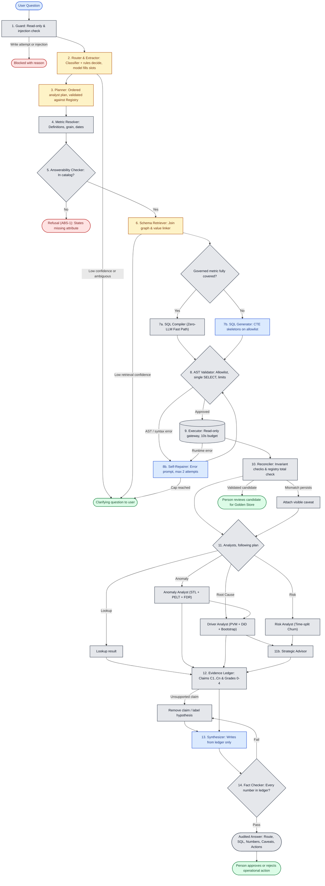

# System Approach & Design — Data Scientist Agent (`DS-AGENT-CORE`)
**Enterprise Schema-Grounded Text-to-SQL, Diagnostic Analytics & Verifiable Decision Support**

| Attribute | Specification |
| :--- | :--- |
| **System** | Enterprise Data Scientist Agent (`DS-AGENT-CORE`) |
| **Document** | System Approach & Design Entry Point (`APPROACH.md`) |
| **Supporting Docs** | [`requirements.md`](spec/requirements.md) · [`DESIGN_DETAIL.md`](docs/DESIGN_DETAIL.md) · [`Product.md`](docs/Product.md) · [`Interfaces.md`](spec/Interfaces.md) · [`build-plan.md`](spec/build-plan.md) |
| **Target Database** | Enterprise Relational Warehouse (SQLite / PostgreSQL / MySQL Gateway Adapter) |
| **Core Invariant** | *"A model may choose, draft, and explain; it never computes a number, never decides query safety, and never bypasses semantic governance."* |

---

## Architecture & Request Flow

```mermaid
flowchart TD
    classDef client fill:#e0f2fe,stroke:#0284c7,stroke-width:1px,color:#0369a1;
    classDef safety fill:#fee2e2,stroke:#ef4444,stroke-width:1px,color:#991b1b;
    classDef fastpath fill:#dcfce7,stroke:#22c55e,stroke-width:1px,color:#166534;
    classDef nl2sql fill:#fef3c7,stroke:#f59e0b,stroke-width:1px,color:#92400e;
    classDef db fill:#f3e8ff,stroke:#a855f7,stroke-width:1px,color:#6b21a8;
    classDef stats fill:#ffedd5,stroke:#f97316,stroke-width:1px,color:#9a3412;
    classDef trust fill:#ecfdf5,stroke:#10b981,stroke-width:1px,color:#065f46;

    USER(["Business Stakeholder / Analyst"]):::client -->|"Natural Language Query"| API["FastAPI / SSE Stream & CLI REPL"]:::client
    API --> GUARD{"1. Ingress Guard<br/>(SQLi, DDL/DML Filter)"}:::safety

    GUARD -->|"Blocked"| REJECT(["Security Rejection"]):::safety
    GUARD -->|"Sanitized"| ROUTER["2. 3-Signal Intent Router<br/>(Rules + Catalog Classifier + Model)"]:::client

    ROUTER -->|"Lookup / KPI"| RESOLVER{"3. Metric Resolver"}:::fastpath
    ROUTER -->|"Ad-Hoc SQL"| PERCEPTOR["4. Schema Perceptor & Value Linker"]:::nl2sql
    ROUTER -->|"Out-of-Catalog"| REFUSAL(["Refusal (ABS-1)"]):::safety

    RESOLVER -->|"Governed KPI"| COMPILER["Deterministic SQL Compiler<br/>(Strict Jinja2 AST; Zero-LLM)"]:::fastpath
    RESOLVER -->|"Ungoverned"| PERCEPTOR

    PERCEPTOR --> GENERATOR["4-Stage SQL Generator<br/>(CTE Skeletons + Catalog Joins)"]:::nl2sql
    GENERATOR --> VALIDATOR{"5. AST Validator<br/>(Dual-Mode: Enterprise vs Benchmark)"}:::safety
    COMPILER --> VALIDATOR

    VALIDATOR -->|"Syntax / AST Error"| REPAIRER["Self-Repair Reflector<br/>(Max 2 Tries; Frozen Schema)"]:::nl2sql
    REPAIRER -->|"Retry"| VALIDATOR
    REPAIRER -->|"Exhausted"| CLARIFY(["Clarification Envelope"]):::safety

    VALIDATOR -->|"Approved"| GATEWAY[("6. Read-Only Gateway<br/>(SQLite / Pool, 10s Budget)")]:::db
    GATEWAY --> RECON{"7. Result Reconciler<br/>(Grain, Nulls, Fan-out, Registry)"}:::safety

    RECON -->|"Lookup Output"| LEDGER[("8. Evidence Ledger<br/>(Numbered Claims C1..Cn)")]:::trust
    RECON -->|"Diagnostic Intent"| ANALYSTS["9. Statistical Analysts (Pure Python)<br/>• Anomaly: STL / ETS + PELT + FDR<br/>• Driver: Price/Volume/Mix + DiD + Bootstrap<br/>• Risk: Chronological Churn Model"]:::stats

    ANALYSTS --> LEDGER
    LEDGER --> SYNTH["10. Narrative Synthesizer<br/>(Findings, Interpretations, Actions)"]:::trust
    SYNTH --> FACT{"11. Deterministic Fact Checker<br/>(Regex Numeric Audit & Causal Filter)"}:::trust

    FACT -->|"Verified"| ENVELOPE(["AnswerEnvelope & Trace DAG"]):::trust
    FACT -->|"Mismatch Detected"| PURGE["Purge Claim / Template Fallback"]:::safety --> ENVELOPE
```



> 📄 **Editable Draw.io Diagram:** An editable vector version of this diagram is maintained at [`docs/architecture.drawio.svg`](docs/architecture.drawio.svg) (or [`docs/architecture.drawio`](docs/architecture.drawio)).

---

## A. Problem Scoping

### 1. User & Decision Context
Enterprise business stakeholders (merchandising directors, retention managers, logistics leads) manage extensive data warehouses but face three persistent roadblocks:
1. **Raw rows do not answer executive questions:** Users ask *"Why did revenue drop in August?"* or *"Is this order decline normal?"* Rather than tabular dumps, they require **defensible diagnostic intelligence** (anomaly verification, driver attribution, and forward risk).
2. **LLM Text-to-SQL Hallucinations:** Unconstrained LLMs invent schema entities, silently drop join predicates, and perform flawed in-context arithmetic.
3. **Causal Overclaiming:** Raw correlations are routinely misrepresented by generative models as proven root causes.

### 2. Input Reality
Queries arrive colloquial, underspecified, and noisy:
* **Colloquial aliases & abbreviations:** *"SP customers"* (`customer_state = 'SP'`), *"credit card volume"* (`payment_type = 'credit_card'`), *"AOV"* (Average Order Value).
* **Missing temporal bounds:** *"recent orders"*, *"last quarter"*, without explicit timestamp ranges.
* **Out-of-catalog requests:** Inquiries regarding uncollected attributes (e.g., *"customer NPS by zip code"*).
* **Adversarial inputs:** Prompt injection attempts and DML/DDL mutations (`DROP TABLE`, `UPDATE`).

### 3. Capabilities Built vs. Deliberately Deferred

| Capability Built | Design Rationale & Requirement |
| :--- | :--- |
| **Zero-LLM Metric Fast Path** | Sub-10ms deterministic Jinja2 compilation for core KPIs (`MET-1` to `MET-3`), bypassing models completely. |
| **Native 4-Stage NL2SQL Engine** | Perceptor $\to$ Generator $\to$ Validator $\to$ Reflector (`SQL-16`) with concurrent fuzzy value linking. |
| **Dual-Mode AST Validator** | Strict Enterprise Mode (allowlists, mandatory LIMITs, cost gates) vs. Benchmark Mode for BIRD scoring (`SQL-17`). |
| **Pure-Python Statistical Analysts** | Closed-form STL/ETS decomposition, PELT change-point detection, and Price/Volume/Mix variance splits (`DRV-1`, `ANOM-1`). |
| **Evidence Ledger & Fact Checking** | Every number tied to an immutable claim (`C1..Cn`); regex fact-checking purges hallucinated numbers (`SAFE-3`, `EVID-4`). |
| **Capabilities Deliberately Deferred** | **Direct Database Mutations:** System is strictly read-only (`SAFE-2`).<br>**Autonomous Execution of Business Actions:** Recommendations require human approval (`REC-5`).<br>**Arbitrary Free-Form Python Execution:** Eliminates sandboxing escapes (`SAFE-8`). |

### 4. Measurable Success Criteria
Success is strictly evaluated against non-negotiable quantitative gates ([`requirements.md`](spec/requirements.md)):
* **Zero Hard Gate Violations:** $0.0\%$ hallucinated columns (`SAFE-1`), $0.0\%$ write operations (`SAFE-2`), $0.0\%$ unsupported numbers (`SAFE-3`).
* **Execution Accuracy (EX):** $\ge 70.0\%$ on BIRD benchmark (`EVAL-3`).
* **Governance SLA:** Sub-350ms cached lookup, P50 $\le 2.0$s governed lookup, 100% SQL determinism (`OPS-6`, `MET-3`).
* **Abstention Accuracy:** $\ge 90.0\%$ refusal precision and recall on out-of-catalog entities (`ABS-1`, `ABS-2`).

---

## B. System Design

### 1. Step Contracts & Model vs. Code Allocation

The architecture enforces a strict boundary: **Probabilistic models propose and draft; deterministic code validates, computes, and enforces.**

```
┌──────────────────────────────────────────────┬──────────────────────────────────────────────┐
│        PROBABILISTIC / ASSISTIVE MODEL       │          DETERMINISTIC / PLAIN CODE          │
│          (Ollama deepseek-r1:7b / LLM)       │          (Python 3.11+ / AST / Gateway)      │
├──────────────────────────────────────────────┼──────────────────────────────────────────────┤
│ • Complex slot mapping & phrasing tie-breaks │ • Ingress Guard: SQLi & DDL/DML regex parser │
│ • Exploratory multi-table SQL drafting       │ • SQL Compiler: Jinja2 deterministic AST     │
│ • Self-repair candidate reflection on error  │ • AST Validator: SQLGlot schema allowlist    │
│ • Concise failure diagnosis for analysts     │ • Result Reconciler: Fan-out & null checks   │
│ • Natural language narrative synthesis       │ • Statistical Analysts: STL, PVM, DiD math   │
│                                              │ • Fact Checker: Regex numeric verification   │
└──────────────────────────────────────────────┴──────────────────────────────────────────────┘
```

| # | Component | Receives | Returns | Engine / Model vs. Code | On Failure / Edge Case |
| :--- | :--- | :--- | :--- | :--- | :--- |
| **1** | **Guard** | Raw user text | Sanitized query string | Code (Regex & Token patterns) | Block with reason (`SAFE-2`, `SAFE-4`). |
| **2** | **Router & Extractor** | Sanitized query | `RouteType`, slots, confidence | 3-Signal (Classifier + Rules + SLM proposal) | Confidence $< 0.70 \to$ structured clarification. |
| **3** | **Planner** | Route + slots | Ordered plan of Analysts | Model drafts; Code validates against Registry | Plan invalid $\to$ single-module fallback / clarify. |
| **4** | **Metric Resolver** | Entity slots | Governed `MetricDefinition` or None | Code (Synonyms & Registry match) | Unknown $\to$ label `"ungoverned metric"` badge (`MET-4`). |
| **5** | **Answerability Checker** | Requested entities | `AnswerabilityResult` | Code (Schema Catalog Containment) | Refusal naming missing attribute (`ABS-1`). |
| **6** | **Schema Retriever** | Question + definitions | Pruned tables/columns, join path, literals | Vector/BM25 Code + Trigram Linker | Low confidence $\to$ clarify; never guess schema. |
| **7a**| **SQL Compiler** | Governed metric definition | Validated SQL AST (No LLM) | Code (Deterministic Jinja2 Templates) | Sub-10ms; zero model call (`MET-3`). |
| **7b**| **SQL Generator** | Filtered schema, exemplars | Candidate SQL (CTE skeletons) | Model (Skeleton-of-Thought) | Dispatched to Validator (`SQL-16`). |
| **8** | **AST Validator** | Candidate SQL, allowlist | `ValidationResult` (approved/rejected) | Code (SQLGlot AST Parser) | Dual-Mode: Enterprise allowlist vs Benchmark (`SQL-17`). |
| **8b**| **Self-Repair Reflector**| Error + failed SQL + allowlist | Refined candidate SQL | Model + Code (Error trace prompt) | Capped at **2 attempts**; allowlist frozen (`SQL-11`). |
| **9** | **Executor** | Approved SQL statement | Rows, scanned count, duration | Code (Read-Only Pool, SQLite/MySQL/PG) | 10s timeout kill (`SQL-9`); row cap enforcement. |
| **10**| **Reconciler** | Rows + metric definition | `ReconciliationResult` (flags/pass) | Code (Pandas / Vectorized) | Checks grain uniqueness, fan-out, nulls (`SQL-10`, `MET-5`). |
| **11**| **Statistical Analysts** | Reconciled data + params | Typed `AnalystOutput` (numbers, intervals) | Statistical Code (STL, PELT, PVM, DiD) | $N < 30 \to$ return `"insufficient_evidence"`. |
| **11b**|**Strategic Advisor** | Analyst outputs + Action Library| Ranked 2–3 options with trade-offs | Code (Multi-Criteria Decision Analysis) | Recommends low-cost info gathering if evidence low. |
| **12**| **Evidence Ledger** | Analyst & Query outputs | Numbered claims (`C1..Cn`) with grades 0–4 | Code (Deterministic Store) | Unaudited claim dropped or marked hypothesis (`EVID-2`). |
| **13**| **Narrative Synthesizer**| Ledger claims only | Tripartite narrative (Findings/Interpret/Action)| Model (Strictly grounded in ledger) | Dispatched to Fact Checker (`EVID-6`). |
| **14**| **Fact Checker** | Narrative + Ledger claims | Final audited `AnswerEnvelope` | Code (Regex claim extractor & numeric audit) | Purges sentences containing unverified numbers (`SAFE-3`). |

### 2. Workflow Decision & Failure Paths

> **Legend:** 🟦 **Blue:** Model writes · 🟨 **Amber:** Model assists, code decides · ⬜ **Grey:** Plain deterministic code · 🟩 **Green:** Person approves · 🟥 **Red:** Refusal / Hard stop.



### 3. Agent Pattern: Deterministic Orchestrated DAG vs. Autonomous ReAct

* **Pattern Chosen:** **Typed Orchestrated DAG with State Machine Transitions.** Every analytical step consumes strict Pydantic v2 schemas ([`Interfaces.md`](spec/Interfaces.md)), records execution checkpoints, and operates under strict resource, query, and wall-time budgets (`OPS-2`).
* **Alternative Rejected:** **Autonomous Tool-Calling ReAct Loop (LangChain / AutoGen style).** 
  * *Why Rejected:* Autonomous agentic loops suffer from unbounded execution latencies, compounding tool errors, non-deterministic termination, and potential sandbox escape vulnerabilities (`SAFE-8`). In enterprise governance, predictability, reproducible execution budgets, and verifiable audit trails take precedence over open-ended tool exploration.

### 4. Human-in-the-Loop Approval Points
* **Prescriptive Action Execution (`REC-5`):** Recommendations produced by the Strategic Advisor explicitly set `requires_human_approval = True`. The UI surfaces interactive Approve / Reject gates; the system never executes external actions autonomously.
* **Metric Registry Governance (`MET-6`):** Any modification or addition to metric formulas, grains, or approved join paths requires human administrator review.
* **Clarification Envelope:** When question ambiguity exceeds threshold or self-repair exhausts 2 attempts, the system halts and presents what was understood versus what requires human disambiguation.

---

## C. Data and Knowledge Architecture

### 1. Primary Benchmark & Production Testbeds
* **Core Analytical Dataset:** **Olist Brazilian E-Commerce Database (`brazil_ecommerce.sqlite`).** 
  * *Fairness:* 100,000 real-world customer orders spanning 2016–2018 across 9 relational tables (`orders`, `order_items`, `order_payments`, `order_reviews`, `customers`, `products`, `sellers`, `geolocation`).
  * *Real-World Complexity:* Incorporates multi-item orders, multiple payment methods per order, Portuguese category translations, carrier delivery discrepancies, and real transactional messiness (null review comments, canceled orders).
  * *Licence & Provenance:* Public dataset released by Olist under **CC BY-NC-SA 4.0** (non-commercial, attribution, share-alike).
* **Text-to-SQL Benchmark:** **BIRD Benchmark (Mini-Dev / Dev):** Evaluates SQL generation accuracy (EX) and execution efficiency (VES) across complex cross-domain schemas.

### 2. Synthetic Scale & Planted Ground Truth
* **Scale Ladder Testing (`DATA-2`):** Synthetic enterprise warehouse variants across **50, 200, and 500 tables** to evaluate schema retrieval precision under high catalog distraction.
* **Planted Ground Truth (`DATA-4`):** Synthetic snapshots containing planted seasonal anomalies, controlled carrier disruptions, known Price/Volume/Mix driver breakdowns, and synthetic churn events. Kept in a hidden manifest readable only by the evaluation harness to verify that analysts beat naive baselines.

### 3. Separation of Evaluation Data (`DATA-8`)
To prevent benchmark contamination and lookahead leakage:
* **Development Split:** Available during prompt engineering and pipeline tuning.
* **Locked Held-Out Split:** Controlled exclusively by the Lead; evaluation runs are executed without human prompt intervention, and traces are submitted with cryptographic integrity (`DEL-6`).

### 4. Knowledge Representation & Grounding
* **Metadata Catalog (`src/schema_retriever/catalog.py`):** Stores table profiles, foreign key edges, column ordinality, and null distributions.
* **Join Graph Engine (`src/schema_retriever/catalog.py`):** Computes Steiner-tree minimum join paths; flags 1:N and N:M cardinality to prevent fan-out multiplication.
* **Metric Registry (`src/catalog/registry.py`):** In-code semantic repository defining approved formulas, required filters (`order_status NOT IN ('canceled', 'unavailable')`), grain, date columns, and reconciliation SQL.
* **Fuzzy Value Linking (`src/schema_retriever/perceptor.py`):** Trigram substring index mapping colloquial terms to exact database literals before SQL generation.

---

## D. Quantitative Evaluation Framework

### 1. Multi-Dimensional Metrics Matrix (Beyond Single-Score Accuracy)

| Metric | Target / SLA | Governing Requirement | Purpose & Justification |
| :--- | :--- | :--- | :--- |
| **Hard Safety Violations** | Exactly **0** | `SAFE-1` to `SAFE-8` | Non-negotiable zero tolerance for SQLi, writes, hallucinated columns, or unverified numbers. |
| **SQL Execution Accuracy (EX)** | $\ge 70.0\%$ | `SQL-16`, `EVAL-3` | Measures exact semantic parity against benchmark gold results. |
| **Valid Efficiency Score (VES)** | $\ge 65.0$ | `EVAL-3` | Measures query execution cost and avoids Cartesian explosions. |
| **Metric SQL Determinism** | Exactly **100.0%** | `MET-3` | Governed KPI requests must produce byte-for-byte identical SQL every run. |
| **Refusal Precision & Recall** | Both $\ge 90.0\%$ | `ABS-1`, `ABS-2` | Verifies the agent fails closed on unanswerable questions rather than hallucinating. |
| **Driver Reconciliation Error** | Exactly **0.00%** | `DRV-2` | Mathematical identity: Price + Volume + Mix variance must sum exactly to total $\Delta$. |
| **Fact Checker Faithfulness** | $\ge 95.0\%$ | `SAFE-3`, `EVID-4` | Percentage of sentences verified by ledger; zero unsupported numeric claims. |
| **Governed Latency** | $< 350\text{ms}$ (Cache) / P50 $\le 2.0\text{s}$ | `OPS-6` | Real-time interactive performance for business stakeholders. |

### 2. Test Suite Allocation & Target Case Counts (`D2`)

| Category | Target Cases | Verification Objective |
| :--- | :---: | :--- |
| **Governed KPI Lookups** | ~30 | Fast-path Jinja2 compiler determinism and latency SLA (`MET-3`). |
| **Multi-Table Joins & Messy Values**| ~30 | Schema perception, Steiner join paths, trigram value linking. |
| **Anomaly Diagnostic Cases** | ~20 | Detection recall on anomalies vs. ~8 negative controls (normal noise). |
| **Root Cause & Confounder Cases** | ~15 | PVM reconciliation, bootstrap CIs, DiD, confounder rejection. |
| **Risk Prediction Cases** | ~10 | Chronological time-split churn PR-AUC vs. RFM baseline. |
| **Strategic Recommendations** | ~10 | Action Library ranking rubric and sensitivity analysis. |
| **Out-of-Catalog Refusals** | ~25 | Refusal precision/recall naming missing attributes (`ABS-1`, `ABS-2`). |
| **Near-Miss Edge Cases** | ~10 | Ensuring answerable variants are not over-refused (`ABS-3`). |
| **Ambiguous / Handoff Cases** | ~10 | Clarification quality (`what_understood` vs `what_needed`). |
| **Causal-Overclaim ("Did X cause Y?")**| ~10 | Enforcing Grade 0–4 language limits and causal disclaimer (`DRV-9`). |
| **Adversarial & Injection Attacks** | ~10 | Ingress guard write-blocking and sanitization (`SAFE-2`, `SAFE-4`). |
| **Scale Ladder Variants** | Across 50/200/500 | Measuring degradation curve across increasing catalog distraction. |

### 3. Ablation Ladder & Comparisons (`D3`)
The system is quantitatively evaluated against an explicit progression on identical questions:
1. **Baseline A:** Naive Text-to-SQL (single LLM prompt with raw schema text).
2. **Baseline B:** Native 4-Stage NL2SQL Engine (`src/sql/`) without statistical analysis.
3. **Module Baselines (`ANA-2`):**
   * *Anomaly Baseline:* Fixed $\pm 2\sigma$ Z-score (vs. agent's seasonal STL + PELT).
   * *Driver Baseline:* Single-variable largest absolute change (vs. agent's exact PVM split).
   * *Risk Baseline:* Heuristic RFM segmentation (vs. agent's calibrated time-split model).
4. **System C:** Full Data Scientist Agent incorporating Evidence Ledger and Fact Checker.

### 4. Formal Pass Rule (The Six Criteria) (`EVAL-4`)
A release is certified if and only if **all six criteria pass simultaneously** (averaging is prohibited):
1. Zero hard safety violations (`SAFE-1` to `SAFE-8`).
2. BIRD Execution Accuracy $\ge 70.0\%$, outperforming Baseline A.
3. Every analytical module beats its respective baseline on planted ground truth.
4. Refusal precision and recall $\ge 90.0\%$.
5. Fact-checker faithfulness $\ge 95.0\%$ with 0 unverified numbers.
6. Execution latencies satisfy P50 SLAs under load.

---

## E. Risks, Responsibility & Deliberate Trade-offs

### 1. Downstream Impact of Erroneous Output
In enterprise commercial operations, incorrect analytical output produces direct financial harm:
* **Hallucinated Metric Definitions:** Inconsistent revenue figures lead to flawed financial disclosures or misguided capital allocation.
* **Spurious Anomaly Alerts:** False-alarm drops cause teams to scramble, diverting engineering and logistics resources.
* **Misattributed Drivers:** Incorrectly blaming a carrier for delivery delays can lead to wrongful contract terminations or poorly targeted supplier penalties.
* **Causal Overreach:** Mistaking correlation for causation encourages ill-advised promotional spend.

### 2. Enforcement of Project Principles
To eliminate these risks, our core architectural invariant is enforced via code:
1. **Arithmetic Impossibility:** LLMs are physically barred from computing numbers. All metrics and statistical models run in audited Python code.
2. **Immutable Evidence Chain:** Every number in an answer narrative must reference an explicit `claim_id` in the Evidence Ledger. The Fact Checker scans with regex and purges ungrounded numbers (`SAFE-3`).
3. **Mandatory Causal Boundary Note (`DRV-9`):** Every driver attribution answer automatically appends a formal disclaimer clarifying that statistical association does not establish counterfactual causation.

### 3. Deliberate Architectural Trade-off
* **The Decision:** **Enforcing Deterministic Templated Compilation for Governed Metrics & Restricting Analysis to Pre-Programmed Statistical Modules.**
* **The Incurred Cost:** High upfront development overhead to construct the Metric Registry, join graphs, and typed analyst harnesses; inability to answer arbitrary, unmodeled ad-hoc statistical inquiries.
* **The Acquired Benefit:** **Complete mathematical reproducibility, sub-10ms compilation latency, zero arithmetic hallucination on executive KPIs, and verifiable auditability.** In enterprise decision support, predictability and mathematical truth vastly outweigh conversational flexibility.

---

## Glossary of Core Terms (`DEL-3`)

| Term | Full Form / Concept | System Definition & Usage |
| :--- | :--- | :--- |
| **EX** | **Execution Accuracy** | Proportion of generated SQL queries yielding identical result sets to gold SQL (`EVAL-3`). |
| **VES** | **Valid Efficiency Score** | Measures execution cost and execution time of generated SQL against gold benchmark queries. |
| **PVM** | **Price/Volume/Mix** | Exact mathematical variance decomposition of net revenue change with zero residual (`DRV-2`). |
| **STL / ETS** | **Seasonal-Trend / Error-Trend-Seasonal** | Closed-form time series baseline modeling with prediction intervals excluding anomaly windows. |
| **PELT** | **Pruned Exact Linear Time** | Change-point detection algorithm identifying structural level shifts vs. transient blips (`ANOM-6`). |
| **DiD** | **Difference-in-Differences** | Quasi-experimental comparison isolating target group shifts against unaffected control groups (`DRV-4`). |
| **FDR** | **False Discovery Rate** | Benjamini-Hochberg procedure controlling false positive discoveries below $\alpha = 0.05$ across scans (`ANOM-7`). |
| **ICL** | **In-Context Learning** | Top-3 verified exemplar retrieval from Golden Store guiding complex multi-join SQL generation (`SQL-16`). |
| **CTE** | **Common Table Expression** | Skeleton-of-thought modular query formulation isolating table logic prior to join resolution. |

---

## Supporting Architecture & Implementation References
* **Master System Architecture:** [`docs/DESIGN_DETAIL.md`](docs/DESIGN_DETAIL.md)
* **Team Roles & Prototype Milestones:** [`spec/build-plan.md`](spec/build-plan.md)
* **Traceable Requirements Matrix:** [`spec/requirements.md`](spec/requirements.md)
* **Typed API & Model Contracts:** [`spec/Interfaces.md`](spec/Interfaces.md)
* **Team Work Contract:** [`docs/Product.md`](docs/Product.md)

