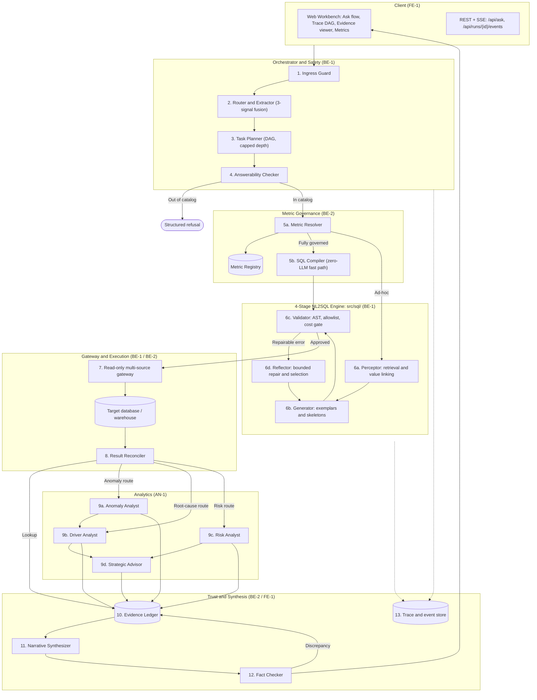
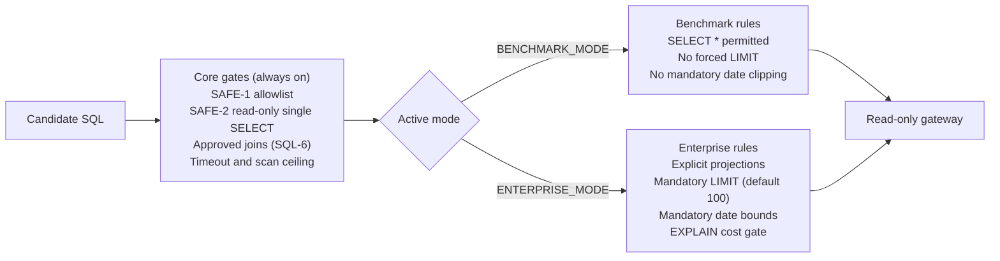

# Data Scientist Agent (`DS-AGENT-CORE`) — Detailed Design

**Enterprise decision intelligence on top of a high-performance, schema-grounded NL2SQL engine**

| | |
|---|---|
| **Status** | Active baseline: master long-form design |
| **Source documents** | [`requirements.md`](../spec/requirements.md), [`Product.md`](Product.md), [`Interfaces.md`](../spec/Interfaces.md), [`build-plan.md`](../spec/build-plan.md) |
| **Target databases** | Dialect-agnostic through a gateway adapter (SQLite, MySQL, PostgreSQL in the prototype) |
| **Derived document** | A shorter A–E entry document (max 4 pages) is derived from this file, with detail moved into linked files |

> **Core principle.** *A model may choose, draft and explain. It never computes a number, never decides whether a query is safe, and never bypasses semantic governance.*
>
> **Project principle.** *Generate only against the retrieved schema; validate every query by execution; measure against a naive baseline.*

> **Targets vs. results.** Every number marked *target* is an acceptance goal, not an achieved result. Results are reported only after the evaluation in Section D has run, together with model name and version, prompt hash, commit hash, data snapshot ID and date.

---

## Contents

1. [Executive summary](#executive-summary)
2. [Section A — Problem scoping](#section-a--problem-scoping)
3. [Section B — System design](#section-b--system-design)
4. [Section C — Data and knowledge](#section-c--data-and-knowledge)
5. [Section D — Evaluation framework](#section-d--evaluation-framework)
6. [Section E — Risks and responsibility](#section-e--risks-and-responsibility)
7. [Section F — Delivery plan](#section-f--delivery-plan)
8. [Appendix — Changes from the previous versions](#appendix--changes-from-the-previous-versions)

---

## Executive summary

Business owners rarely need a table of rows. They need to know **whether a change is unusual, what is driving it, and what to do next**, with enough evidence to defend the decision. Plain text-to-SQL fails here for four reasons:

1. It hallucinates tables and columns, so the numbers underneath cannot be trusted.
2. It cannot find the right tables among hundreds.
3. It returns rows, not an answer to "is this unusual?" or "why?".
4. It lets a language model do arithmetic and causal reasoning it is not reliable at.

The design is therefore a **controlled analytical workflow with two cooperating engines**:

| Engine | Responsibility |
|---|---|
| **Governance and Analytics Brain** | Intent routing, planning, metric governance with a deterministic SQL compiler, statistical analysts (anomaly, driver, risk), action ranking, evidence grading (Tiers 0–4) and fact-checking of every number. |
| **4-Stage Query Engine** (`src/sql/`) | Perceptor → Generator → Validator → Reflector for ad-hoc and exploratory questions: concurrent value linking, in-context exemplars, deterministic AST validation, bounded repair, and a multi-dialect read-only gateway (`src/gateway/`). |

The workflow is: **route → ground in the real schema → compile or generate SQL → validate → execute read-only → reconcile → run a tested statistical/ML module → write the answer only from recorded evidence.**

```
                 ┌──────────────────────────────────────────────┐
                 │            Incoming business question         │
                 └──────────────────────┬───────────────────────┘
                                        ▼
                 ┌──────────────────────────────────────────────┐
                 │ 1. INGRESS GUARD  (injection, DDL/DML denial) │
                 └──────────────────────┬───────────────────────┘
                                        ▼
                 ┌──────────────────────────────────────────────┐
                 │ 2. ROUTER, EXTRACTOR, PLANNER, ANSWERABILITY  │
                 └───────────┬───────────────────────┬──────────┘
              Governed metric│                       │Ad-hoc / exploratory
                             ▼                       ▼
              ┌─────────────────────────┐ ┌─────────────────────────┐
              │ 3a. METRIC COMPILER     │ │ 3b. 4-STAGE NL2SQL      │
              │ deterministic, no LLM   │ │ Perceptor · Generator · │
              │                         │ │ Validator · Reflector   │
              └────────────┬────────────┘ └────────────┬────────────┘
                           └──────────────┬────────────┘
                                          ▼
                 ┌──────────────────────────────────────────────┐
                 │ 4. AST VALIDATOR + COST GATE (core gates      │
                 │    always on; mode-specific rules on top)     │
                 └──────────────────────┬───────────────────────┘
                                        ▼
                 ┌──────────────────────────────────────────────┐
                 │ 5. READ-ONLY MULTI-SOURCE GATEWAY             │
                 │    (timeouts, row caps, scan budget)          │
                 └──────────────────────┬───────────────────────┘
                                        ▼
                 ┌──────────────────────────────────────────────┐
                 │ 6. RECONCILER & AUDIT (grain, nulls, dupes)   │
                 └──────────────────────┬───────────────────────┘
                                        ▼
                 ┌──────────────────────────────────────────────┐
                 │ 7. ANALYSTS (code only): Anomaly · Driver ·   │
                 │    Risk · Strategic Advisor                   │
                 └──────────────────────┬───────────────────────┘
                                        ▼
                 ┌──────────────────────────────────────────────┐
                 │ 8. EVIDENCE LEDGER & NARRATIVE FACT CHECKER   │
                 └──────────────────────┬───────────────────────┘
                                        ▼
                 ┌──────────────────────────────────────────────┐
                 │ Executive answer + auditable trace             │
                 └──────────────────────────────────────────────┘
```

---

## Section A — Problem scoping

### A1. Users, decisions and input reality

**Users.** Business owners who sit on a large data warehouse but cannot write SQL or debug statistics: a commercial strategy lead, a supply-chain or operations head, a retention/CRM manager.

**Their three questions.**

1. *Is this change unusual?* (anomaly detection)
2. *What is driving it?* (driver attribution)
3. *What should we do next?* (prescriptive decision support)

**How input really arrives.** Questions are ambiguous, high-context and written in business words, not table names:

- "Weekly orders in one region dropped sharply last month. Is that unusual, and what is driving it?"
- "Which customer segments are we most likely to lose next quarter, and where should we act first?"
- "What was revenue by category last year?" (a plain lookup)
- "What is the average customer age by region?" (the attribute may not exist)
- "Did the new carrier cause the delays?" (a causal claim the data may not support)

Real inputs also contain synonyms, cryptic abbreviations (`cust_cd`, `tx_amt`), typos, relative dates ("last month", "next quarter"), undefined business terms ("active customer", "margin"), unindexed categorical values ("SoCal region"), compound intent, and sometimes instructions embedded in text.

### A2. Question classes and routing

| Class | Example | Processing path | Owner |
|---|---|---|---|
| **Governed lookup** | "What was ARR by region in Q3?" | Metric Resolver → SQL Compiler (no LLM) → Executor | BE-1 / BE-2 |
| **Ad-hoc / exploratory SQL** | "List customers who ordered in June but had returns in July" | Perceptor → Generator → Validator → Reflector | BE-1 |
| **Anomaly diagnostic** | "Weekly orders in the Northwest dropped sharply last month. Is that normal?" | Query engine → seasonal baseline → PELT change-point → Anomaly Analyst | AN-1 |
| **Root cause / driver** | "What drove the $1.2M gross-margin decline in EU apparel?" | Query engine → price/volume/mix → difference-in-differences → Driver Analyst | AN-1 |
| **Risk prediction** | "Which Tier-1 accounts have the highest churn risk next quarter?" | Query engine → leakage-safe time-split features → calibrated gradient-boosted model | AN-1 |
| **Recommendation** | "Where should we reallocate the logistics budget to fix delivery delays?" | Analyst outputs → Action Library ranking → sensitivity and trade-offs | AN-1 / Lead |
| **Ambiguous** | "How are sales doing?" | Structured clarification (what was understood vs. what is needed) | BE-1 |
| **Unanswerable** | "Average customer NPS by zip code?" (NPS not collected) | Refusal naming the missing attribute (fail closed) | BE-1 / BE-2 |
| **Unsafe / injection** | "Drop table audit_log;" or injection payloads | Ingress Guard blocks with a reason; zero execution | BE-1 |

### A3. Built vs. deliberately deferred

| Area | Built | Deferred |
|---|---|---|
| Routing | Hybrid router: trained lightweight classifier + rules + model proposal, validated against an allowlist | Learned multi-turn dialogue management |
| Schema grounding | Metadata catalog, column profiles, join graph, hybrid retrieval, value linking, retrieval-confidence refusal | Automatic schema migration; any write or DDL |
| SQL | Compiler for governed metrics; 4-stage model generation for the rest; AST validation; execution validation; bounded repair | Sandboxed model-written Python |
| Anomaly detection | Seasonal baseline with prediction intervals, robust scoring, multiple-testing control, volume guard | Bayesian structural time series; multi-year seasonal models |
| Root cause | Contribution decomposition, price/volume/mix, bootstrap intervals, comparison-group check, graded evidence labels | Full causal-graph estimation |
| Risk prediction | Explicit churn definition, time-split features, baseline vs. gradient boosting, calibration | Survival models; uplift modelling |
| Recommendations | Ranked options with assumptions, trade-offs and sensitivity | Autonomous execution of actions |
| Evidence | Evidence Ledger, Fact Checker, step-by-step trace | Multi-user access control; row-level security |
| Deployment | Public web app with trace view and metrics dashboard | Multi-tenant scaling; voice interface |

### A4. Success criteria (targets to be measured)

Grouped so that no single average can hide a failure.

**Hard safety gates: must be exactly zero**

1. Executed queries that reference a table or column outside the retrieved allowlist (`SAFE-1`).
2. Executed write, DDL or file-access statements (`SAFE-2`).
3. Numeric claims in a final answer with no link to a query result or module output (`SAFE-3`).

**SQL quality** (relative to the naive baseline, same questions, same model budget)

4. Result-match execution accuracy against gold answers or invariants, clearly above the naive baseline; schema-hallucination rate far lower.
5. Required-table recall@k high enough that retrieval is never the bottleneck, measured separately from generation.

**Analysis quality** (against planted ground truth)

6. Anomaly module: recall on planted anomalies and false-alert rate on negative controls, both reported.
7. Root-cause module: top-1 and top-3 hit rate on planted drivers; contribution reconciliation error of zero.
8. Risk model: PR-AUC and lift at contact capacity beating the simple baseline on a chronological hold-out; calibration reported.

**Behaviour**

9. Refusal and clarification: precision and recall both reported; near-miss answerable questions must not be over-refused.
10. Causal discipline: on "did X cause Y" cases the answer never claims more than the evidence tier allows.

**Operations**

11. Latency (p50/p95) and cost per query, measured on the running system per route and compared with the baseline.

---

## Section B — System design

### B0. Agent pattern: chosen and rejected

**Chosen: a fixed, typed workflow with bounded tool use.** The order of steps is defined in code. Models are called at specific steps (proposing a route, generating SQL, repairing SQL, writing the narrative) and every model output is validated by deterministic code before anything runs. Each Analyst is a tested function with a typed input and output.

**Rejected: an open-ended tool-using agent** that picks its own sequence and writes arbitrary SQL or Python. It is more flexible, but cost and latency are unbounded, behaviour is hard to audit step by step, it can route around an allowlist, and its numbers would come from unverified model-written code.

**Rejected: a single-prompt text-to-SQL system** as the product. It is kept only as the *naive baseline* (Baseline A) that the agent is measured against.

**Revisit condition.** If evaluation shows frequent questions that need a module the registry lacks, add a new module through the Analyst registry (B10), never free-form code execution.

### B1. Component architecture



### B2. Step contracts

| # | Step | Component | Receives | Returns | Model or code | On failure |
|---|---|---|---|---|---|---|
| 1 | Ingress Guard | `Guard` | Raw text, user context | Sanitized text or rejection code | Code (`sqlglot`, rules) | Hard block on write statements, stacked queries, injection patterns |
| 2 | Routing and extraction | `Router` | Sanitized text | `RouteType`, slots (metric, dimension, time grain, filters), confidence | Classifier + rules decide; model only proposes | Confidence below 0.70 → clarifying question |
| 3 | Planning | `Planner` | Route, slots | Ordered DAG of Analysts (depth capped), validated against the Analyst registry | Model drafts; code validates | Invalid plan or loop → single-module fallback or clarification |
| 4 | Answerability | `AnswerabilityChecker` | Requested entities | Answerable / not answerable + missing items | Code + retrieval confidence | Refusal naming the missing attribute |
| 5 | Metric resolution | `MetricResolver` | Slots | Governed `MetricDefinition` or `UngovernedToken` | Code (exact + synonym match) | Unmapped term → visible `ungoverned_metric` badge |
| 6a | Fast path | `SQLCompiler` | Metric definition, dimensions, time bounds | Compiled SQL AST in the target dialect | Code (AST builder) | Zero LLM calls; identical inputs give identical SQL |
| 6b | Schema perception | `Perceptor` | Question, definitions | Pruned tables, column allowlist, join path, linked literals, column warnings | Embedding/reranker models + code | Low confidence → clarify or refuse |
| 6c | Candidate generation | `SQLGenerator` | Pruned schema, exemplars, question | One or more candidate SQL statements | Model (tiered) | Goes to the Validator |
| 7 | Validation | `Validator` | SQL, dialect, active mode, allowlist, join graph | Validation report (`valid`, errors, estimated cost) | Code only (`sqlglot`) | Repairable error → Reflector; policy violation → reject and log |
| 8 | Self-repair | `Reflector` | Failed SQL, error text, same schema | Patched SQL (max 2 attempts) | Model, capped by code | Cap reached → structured clarification |
| 9 | Execution | `Gateway` | Approved SQL, timeout (default 10 s) | Arrow/Pandas frame, timing, rows scanned | Code (read-only pool) | Timeout or memory overflow → kill and degrade gracefully |
| 10 | Reconciliation | `Reconciler` | Frame, expected invariants | Reconciled frame, flags, audit report | Code (Pandas/Polars) | One retry, then visible caveat |
| 11 | Anomaly analytics | `AnomalyAnalyst` | Regular series, calendar metadata | `AnomalyReport` | Statistical code | Fewer than 12 periods → `insufficient_history` |
| 12 | Driver analytics | `DriverAnalyst` | Baseline and comparison frames, target metric | `DriverReport` (PVM, intervals, DiD) | Deterministic math | Reconciliation must hold exactly (`DRV-2`) |
| 13 | Risk analytics | `RiskAnalyst` | Feature snapshot, cut-off date | `RiskReport` (ranking, PR-AUC, calibration) | ML code | Chronological splits prevent leakage |
| 14 | Advice | `Advisor` | Analyst reports, Action Library | 2–3 ranked options with assumptions and sensitivity | Code (MCDA) | Evidence grade below 2 → cheapest information-gathering step |
| 15 | Ledger | `EvidenceLedger` | All numeric outputs | Numbered claims linked to queries/artifacts with grades | Code | Unsupported claim dropped or labelled hypothesis |
| 16 | Synthesis | `Synthesizer` | Ledger only | Plain-language answer and next steps | Model | Fact Checker; regenerate or template fallback |
| 17 | Fact check | `FactChecker` | Narrative, ledger | Pass / fail per sentence | Code (claim extractor + numeric matcher) | Offending sentence removed or replaced |

### B3. Model vs. plain code

| Model (probabilistic, assistive) | Plain code (deterministic) |
|---|---|
| Proposes route and slot candidates; drafts the module order | Final routing decision, thresholds, allowlists, plan validation |
| Drafts SQL for ungoverned or exploratory questions; selects exemplars | SQL Compiler for governed metrics; AST validation of every query |
| Proposes SQL repairs from error messages | Retry caps, frozen schema allowlist, cost gate, read-only execution |
| Drafts the narrative from the Evidence Ledger | All arithmetic, variance splits, statistics, forecasts, model training and scoring, Reconciler, Advisor ranking, Fact Checker |

> **Invariant (`SAFE-8`).** A language model never performs arithmetic, computes variance, evaluates statistical significance, or decides whether a query is authorized to run.

### B4. Router, Extractor and Planner

- **Three signals combined.** (1) A small trained classifier over question text gives a route label. (2) Deterministic rules look for verbs such as "why", "unusual", "likely to lose" and for time comparisons. (3) A model proposal fills slots. Code takes the final decision; disagreement between signals lowers confidence.
- **Low confidence** (below 0.70) produces a clarifying question stating *what was understood* and *what is needed*.
- **Route and reason are shown in every answer**, for example: "Treated as anomaly + root cause, because the question asks whether a change is unusual and what is driving it."
- **Planner.** Compound questions ("is it unusual and why") become an ordered plan of Analysts with capped depth. The model drafts the plan; code validates it against the Analyst registry, so the Planner can never invent a step.
- **Training and evaluation.** Curated questions per route plus synthetic paraphrases; reported as routing accuracy with a confusion matrix that includes the ambiguous and out-of-scope classes.

### B5. Metric Registry, Metric Resolver and the two SQL paths

The Metric Resolver consults the Metric Registry on **every** question, before any SQL is produced. Each metric records: name and synonyms, formula, required filters (for example, exclude cancelled orders from revenue), time grain, date column, allowed dimensions, base table and join path with cardinalities, reconciliation value, and known caveats.

| Situation | SQL path | Labelling |
|---|---|---|
| Fully governed (metric + allowed dimensions) | **SQL Compiler**: no model call, same SQL every time, lowest latency and cost | None |
| Partly governed or analytical | **4-stage engine** with governed definitions injected as hard constraints (formula, filters, join path, grain) | None |
| No governed metric | **4-stage engine** | Visible `ungoverned_metric` badge |

**Reconciliation.** For any governed metric in a result, the total is compared with the registry's own value for the same metric, period and filters, within a stated tolerance. A mismatch triggers one retry (counting toward the repair cap), then a visible caveat.

**Registry changes** are proposed in code review and approved by a person (see B12). Changing the registry increments `catalog_version`.

### B6. Knowledge onboarding and schema retrieval (built for hundreds of tables)

#### Offline build (runs at first warehouse connection, then on a schedule)

| Artifact | Contents |
|---|---|
| **Metadata catalog** | DDL, constraints, descriptions, and a profile per column: type, null rate, distinct count, min/max, formats, sample values (sensitive columns masked) |
| **Join graph** | Tables as nodes, joins as edges with cardinality. Declared foreign keys are used where they exist. Where they do not (the usual enterprise case), a small classifier proposes joins from name similarity, value overlap and type match; edges are verified empirically (key uniqueness, containment) and carry an approval status |
| **Table trust features** | Freshness, row count, duplicate rate, usage in historical queries, "likely stale copy" flag, so the maintained table is preferred over an old duplicate |
| **Search indexes** | Keyword index (exact identifiers matter) and dense index (business synonyms) over tables, columns, descriptions and golden queries |
| **Value index** | Over categorical and low/medium-cardinality text columns; trigram or n-gram lookup at query time for high-cardinality fields such as names |

#### Online retrieval (the Perceptor)

1. **Hybrid retrieval:** keyword and dense results fused with reciprocal rank fusion, then a cross-encoder reranker.
2. **Recall first:** a missing table cannot be recovered downstream, so retrieval uses a score threshold rather than a fixed top-k, then prunes.
3. **Join expansion:** bring in bridge tables along the join graph; find join paths with shortest-path or Steiner-tree approximation using approved edges only.
4. **Column pruning:** keep only relevant columns per table, plus keys.
5. **Concurrent value linking:** worker threads (`value_search_workers: 4`) search up to 80 candidate values to map phrases to stored literals ("SoCal" → `'CA-SOUTH'`; "US Western" → `state_code IN ('CA','OR','WA')`), each with a confidence score. Low confidence triggers a clarifying question.
6. **Column warnings:** profile facts are passed to the generator ("40% null", "mixed date formats", "soft-deleted rows flagged by a status column").
7. **Refusal rule:** if the needed table or attribute cannot be retrieved with adequate confidence (score below 0.40 or ambiguous joins), the system clarifies or refuses. It never asks the model to fill the gap.

### B7. The 4-stage NL2SQL engine (`src/sql/`)

Used for every question the SQL Compiler cannot cover.

| Stage | File | What it does |
|---|---|---|
| **1. Perceptor** | `src/sql/perceptor.py` | Hybrid schema retrieval, join expansion, column pruning, concurrent value linking (B6) |
| **2. Generator** | `src/sql/generator.py` | Pulls the top 3 verified exemplars from the Golden Store (`icl_top_k: 3`); uses skeleton-of-thought (CTE skeleton first, then join predicates) for multi-condition queries; the model tier is chosen by a predicted-difficulty signal |
| **3. Validator** | `src/sql/validator.py` | Pure deterministic AST validation (`sqlglot`). Never calls a model (`SAFE-8`). Ten checks listed below |
| **4. Reflector** | `src/sql/repairer.py` | Bounded self-repair and optional candidate selection (B9) |

#### Validator checks (in order)

1. Parse in the target dialect; reject parse errors.
2. Exactly one statement; root must be a read-only `SELECT` (read-only CTEs allowed).
3. Reject DML, DDL, stacked statements, file-reading and extension functions, system-catalog access.
4. Check every table and column against the **retrieved allowlist**; unknown identifiers are rejected before execution (`SAFE-1`).
5. Check every join against **approved join-graph edges**; flag fan-out risk (an aggregate over a table also joined across a one-to-many edge).
6. Apply mode-specific rules: row limits, date bounds, projection rules (see B8).
7. **Cost gate:** dry-run or `EXPLAIN` to estimate scanned data; reject or rewrite above budget; prefer pre-aggregated tables where the catalog marks one.
8. Execute on a **read-only connection** with timeout and result-size caps.
9. Post-execution checks: expected columns, grain, duplicates, NULL behaviour, sane ranges.
10. Reconcile with the Metric Registry where a governed metric is present.

A statement that parses is not proof that it answers the question, which is why steps 5, 9 and 10 exist.

### B8. Dual validation modes: benchmark vs. enterprise

Academic benchmarks (BIRD, Spider) and production warehouses want different output shapes. The Validator therefore runs in one of two modes, **while a fixed core of safety gates stays identical in both**.



| Rule | Benchmark mode | Enterprise mode |
|---|---|---|
| Table/column allowlist (`SAFE-1`) | **On** | **On** |
| Read-only single `SELECT` (`SAFE-2`) | **On** | **On** |
| Approved join paths | **On** | **On** |
| Execution timeout and hard scan ceiling | **On** | **On** |
| `SELECT *` | Permitted | Rejected |
| Forced `LIMIT` | Off | On (default 100 rows) |
| Mandatory date window | Off | On |
| `EXPLAIN` cost-gate rejection | Warn and log only | Reject or rewrite |

**Guard rails around the mode switch.**

- The mode is set **only by deployment configuration**, never by user input, a prompt, or retrieved data.
- Benchmark mode is used only against benchmark databases and is refused by the gateway on any enterprise data source.
- The active mode is **recorded in every trace and every evaluation report**, so a benchmark score is never presented as an enterprise-mode score.
- Hard gates (`SAFE-1` to `SAFE-8`) are scored in both modes; a violation in benchmark mode still fails the run.

### B9. Repair, candidate selection and graceful degradation

- **Maximum 2 repair attempts** (`SQL-11`). The repair prompt contains the error, the failed SQL and the **same** approved schema. The schema is never auto-widened.
- **Order:** parse error → regenerate with the AST error; still failing → rule-based dialect fixes → stop. Runtime binder/catalog errors → targeted hints, then full revalidation.
- **Only repairable errors are repaired.** A policy violation (write, DDL, unknown identifier) is rejected and logged, not "fixed" by the model.
- **Reconciliation mismatch** → one retry that counts toward the cap, then a caveat.
- **Empty results are not automatically wrong** (`SQL-12`). The Reconciler distinguishes "empty because a filter is wrong" (value mismatch, impossible date range) from "empty because that is the truth", and never pushes the generator toward non-empty output.
- **Optional candidate voting** (evaluated as an ablation, off by default): generate several candidates for hard questions, execute them under the cost gate, and choose by result agreement. Disagreement lowers confidence and triggers a clarification.
- After the cap, a policy violation, or repeated logical failure → structured clarification (`what_understood` / `what_needs_clarification`).

---

### B10. Analysts and Advisor

All modules share one contract: **typed input tables + parameters → typed output** containing numbers, intervals, flags, assumptions and an explicit *insufficient evidence* state. Every module has unit tests (sparse data, zero baseline, empty segments, short history) and is scored against planted ground truth (Section D).

**Analyst registry.** A new analysis (for example forecasting or cohort comparison) is added by registering a module with its contract, tests and evaluation cases. Free-form code execution is not permitted.

#### B10.1 Anomaly Analyst (`src/analysts/anomaly.py`)

- **Data preparation:** aggregate to a regular series at the question's grain; drop incomplete boundary periods; flag sparse or truncated history; add calendar features (holidays, promotions) from a calendar table when available.
- **Baseline:** seasonality-aware expectation (seasonal-trend decomposition or seasonal-naive/ETS forecast) with a prediction interval, fitted on history that **excludes** the tested period. Falls back to a trailing-window robust baseline (median and MAD) when history is too short, and says so.
- **Scoring:** actual vs. expected, percentage deviation, robust score, interval position, and persistence (one odd week vs. a sustained shift).
- **Change-point check:** PELT separates a sudden level shift from drift or a one-off spike.
- **Many series:** when scanning many regions or segments, control false discoveries with Benjamini–Hochberg (alpha = 0.05) or stricter, and report the correction used.
- **Guards:** fewer than 12 periods → `insufficient_history`; volume below minimum support (N < 30) → `insufficient_evidence`. No label is forced.
- **Output:** verdict (unusual / within normal range / insufficient evidence), expected range, deviation, window, threshold, correction used, calendar effects considered.

#### B10.2 Driver Analyst (`src/analysts/driver.py`)

- **Define first:** metric, current period, comparison period, and a metric tree (orders = customers × orders per customer; revenue = volume × price × mix).
- **Contribution decomposition** over mutually exclusive dimensions (category, channel, carrier, region, customer group):

  ```
  contribution_i = current_i − baseline_i
  share_i        = contribution_i / total_change
  ```
  Contributions must reconcile to the total within tolerance.

- **Price / volume / mix (PVM)** for value metrics. With period 0 as baseline and period 1 as current, per category `i` (price `P`, volume `V`, volume share `s`), total volume `V_tot = Σ V_i`, and baseline average price `P̄0 = Σ(P0_i · V0_i) / V0_tot`:

  ```
  Price effect  = Σ_i (P1_i − P0_i) · V1_i
  Volume effect = (V1_tot − V0_tot) · P̄0
  Mix effect    = V1_tot · Σ_i (s1_i − s0_i) · (P0_i − P̄0)

  Price + Volume + Mix  ≡  ΔRevenue        (zero residual, DRV-2)
  ```

- **Uncertainty:** bootstrap intervals (1,000 resamples) on contributions; show sample sizes; flag unstable shares from small cells.
- **Co-movement evidence:** test whether candidate operational indicators (delivery delay, stock-outs, discount depth) moved in the same window and, where data allows, at a lag; report association strength and its limits.
- **Comparison group:** where a comparable unchanged group exists, run a difference-in-differences comparison to test whether the shift is specific to the affected unit.
- **Search control:** cap the number of dimensions and drill-down depth, and correct for the number of candidate drivers examined, to avoid finding a "driver" by chance.
- **Output:** ranked drivers with share, interval, sample size, evidence grade (B11), and the data that would be needed to strengthen the claim.

#### B10.3 Risk Analyst (`src/analysts/risk.py`)

- **Explicit definition:** a customer is "lost" if there is no purchase in the N days after a cut-off date (for example 60). N and the active-customer definition come from the Metric Registry. If most customers are one-time buyers, that is stated in every answer.
- **Leakage-safe design:** features use only data before the cut-off; train/validation/test splits are **chronological**; nothing from the outcome window enters any feature.
- **Features:** recency, frequency, monetary value, tenure, inter-purchase gaps, recent spend trend, service-quality signals (delays, complaints, review scores), category and region.
- **Models:** a heuristic RFM segmentation and a regularised logistic regression as baselines, versus a gradient-boosted model. The complex model ships only if it beats the baseline on the hold-out.
- **Evaluation:** PR-AUC reported with prevalence, ROC-AUC, Brier score, calibration curve, and precision/lift at the team's contact capacity (top-k).
- **Segment view:** predicted risk is aggregated to business segments with expected revenue at risk = probability × customer value, with resampling intervals.
- **Output:** ranked segments, risk drivers (feature importance as association, not cause), calibration note, and limits (short history, class imbalance).

#### B10.4 Strategic Advisor (`src/analysts/advisor.py`)

- **Inputs:** analyst outputs plus an **Action Library**: curated actions linked to driver types, with preconditions, owner, typical lead time and cost class.
- **Ranking:** multi-criteria score = estimated impact × evidence grade × feasibility. Impact comes from quantified data (revenue at risk, share of decline), not from the model's opinion.
- **Output:** two to three options with assumptions, trade-offs, sensitivity to the key assumption, what to monitor, and what extra data would change the ranking.
- **Weak evidence (grade below 2):** recommend the cheapest *information-gathering* step (for example "check the carrier's delay log for this region") instead of a costly intervention.
- **The agent recommends; a person decides.** It never executes actions.

### B11. Evidence grading, Evidence Ledger and Fact Checker

#### Evidence grades

| Grade | Name | Meaning | Allowed wording (example) |
|:---:|---|---|---|
| **0** | Descriptive fact | Direct aggregation from a validated query | "Orders fell 18.4% versus the seasonal baseline." |
| **1** | Concentration | Decomposition shows the change is concentrated in a sub-segment | "The decline is concentrated in Category X (62% of the change)." |
| **2** | Co-movement | Two variables moved in the same window | "Delivery delays rose over the same three weeks." |
| **3** | Specific to unit | Difference-in-differences shows the shift is unique to the affected unit | "The decline was unique to Region North; control regions stayed stable." |
| **4** | Plausible mechanism | A domain rule links driver to outcome, but unobserved factors remain | "Consistent with a carrier disruption; confirming this requires log inspection." |

> **Blocked wording.** "Caused", "because of" and "due to" are blocked by the Fact Checker unless a grade-4 label is attached and the limits are stated. Every driver analysis ends with the causal-boundary note (E5).

#### Evidence contract (every answer contains)

**Route and reason** · **conclusion** (only what the evidence supports) · **scope** (metric, window, filters, grain, data range) · **evidence** (actual vs. expected, contributions, counts, intervals) · **method and parameters** · **executed SQL with status and timing** · **trace** (retrieved schema, join path, validations, repairs, active validation mode) · **caveats** · **next action** (human approval for any operational step) · **run metrics** (latency, tokens, queries, rows, retries).

#### Evidence Ledger and Fact Checker

1. Every numeric output from the Executor, Reconciler and Analysts gets a unique ID and is written to the **Evidence Ledger**, linked to a query ID or module artifact and an evidence grade.
2. The Narrative Synthesizer writes the summary from ledger entries only. It may paraphrase but may not introduce a figure.
3. The deterministic **Fact Checker** extracts every number from the draft (regex + numeric matcher) and checks it against the ledger:
   - exact or rounded match within ±0.01% → verified;
   - unverified number → the sentence is removed, relabelled as a hypothesis, or replaced with a template sentence;
   - if the narrative cannot be repaired, the answer falls back to a template built directly from the ledger.

### B12. Human-in-the-loop points

| Point | What the person does |
|---|---|
| Clarification | Answers the question when intent, a term or a value is ambiguous |
| Recommendation | Approves or rejects any operational action; the agent never acts |
| Golden Store | Reviews a validated query before it becomes a reusable exemplar |
| Metric Registry changes | Approves new or changed metric definitions |
| Low-confidence answer | Sees an explicit confidence note and can request an analyst review |

### B13. Failure modes and recovery

The system is **fail-closed**: it never guesses, never approximates an ungoverned metric, and never invents a number.

| Failure mode | Trigger | System response | Outcome |
|---|---|---|---|
| Ambiguous ask | Missing grain, conflicting filters, several readings | Structured clarification: `what_understood`, `what_needs_clarification` | HTTP 200, `status: "clarify"` |
| Out of catalog | Metric, dimension or table not in the catalog | Refuse; name the missing attribute; suggest the nearest answerable question (`ABS-1`) | HTTP 200, `status: "refused"` |
| Ungoverned metric | No Registry entry | Exploratory path with a prominent `ungoverned_metric` badge | HTTP 200 with warning |
| Low retrieval confidence | Score below 0.40 or ambiguous joins | No generation; ask the user to clarify entities; never invent mappings | HTTP 200, `status: "clarify"` |
| SQL validation failure | Parse/binder error, unapproved join | Reflector repair (max 2, frozen schema); then clarification | Bounded repair or clarify |
| Policy violation | Write/DDL, unknown identifier, injection | Reject, log, no repair, zero execution | Blocked with reason |
| Timeout or cost | Over 10 s wall time or scan budget (10M rows) | Terminate; suggest a narrower window or partition filter | HTTP 429, `budget_exceeded` |
| Reconciliation mismatch | Total differs from registry value | One retry, then answer with a visible caveat | Caveat |
| Empty result | Zero rows | Distinguish true empty from broken filter; never fabricate rows | HTTP 200 with empty flag |
| Insufficient history or volume | Fewer than 12 periods or N below 30 | "Insufficient evidence", with what would be needed | Analyst status |
| Model outage | LLM unavailable, timeout, rate limit | Governed metrics fall back to the Compiler; exploratory returns a clear error, never a guess | Fallback or 503 |
| Fact Checker mismatch | Ungrounded number in narrative | Remove or relabel the sentence; template fallback if needed (`SAFE-3`) | Narrative repaired |
| Prompt injection | Instructions inside data or question | Treated as data, not instructions; blocked or ignored; logged | Logged |

### B14. Accuracy, latency and cost design

#### Execution tiers

| Tier | Used for | Model cost |
|---|---|---|
| **Tier 0** | Governed metrics: deterministic compiler | None; fully reproducible |
| **Tier 1** (fast, small model) | Routing assistance, slot filling, query explanation, narrative drafting | Low |
| **Tier 2** (strong reasoning model) | Complex multi-table SQL and bounded repair only, chosen by a predicted-difficulty signal | Higher |

#### Caching

- **Exact-match cache:** key `SHA256(normalized_question + session_tenant)`; returns a validated answer envelope in under 50 ms.
- **Slot-based plan cache:** key `(metric_id, grain, dimension_set, filter_signature, catalog_version)`; skips retrieval and LLM planning on a hit (target at most 350 ms).
- **No raw embedding-similarity cache.** "Texas" and "California" questions embed almost identically but need different SQL.
- **Invalidation:** any change to schema metadata, column profiles or the Metric Registry increments `catalog_version`. Cache entries are scoped by user permission.

#### Budgets

| Budget | Limit |
|---|---|
| Prompt tokens | Max 4,000 per analytical stage |
| Database queries | Max 3 per question (1 initial + 2 repairs) |
| Governed lookup latency | P50 ≤ 2.0 s, P95 ≤ 2.5 s (cache hit ≤ 350 ms) |
| Diagnostic analysis latency | Initial target P50 ≤ 4.5 s, P95 ≤ 8.0 s; hard kill at 10 s |
| Average cost per query | ≤ $0.02 (zero model cost on the fast path) |

> **The 4.5 s diagnostic target is a placeholder.** STL/PELT plus 1,000 bootstrap resamples is heavy. The real budget is profiled on the development set and frozen in `spec/thresholds.md` before the held-out run (`OPS-6`, `EVAL-7`).

Other measures: small prompts by design (retrieval keeps the prompt to a handful of tables), cost gate before execution, pre-aggregated tables preferred, parallel execution of independent module queries, and budgets enforced by the orchestrator and visible in the trace.

### B15. Security and governance

- Read-only credentials; no write path exists in the application.
- Sensitive columns are masked or excluded from profiles, prompts, traces and logs.
- Text read from the database (including values pulled in by value linking) is **data, never instructions**.
- Access scoping per user for tables, columns and cached results is a design hook now; full row-level security is deferred.
- Benchmark mode cannot be enabled through user input and is refused on enterprise data sources (B8).

---

## Section C — Data and knowledge

### C1. Three data tiers, each proving something different

| Tier | Data | Purpose | What it proves |
|---|---|---|---|
| **1. Public NL2SQL benchmarks** | BIRD Mini-Dev (500 questions) and Dev (1,534); other public databases chosen after a licence check | Real schemas, dirty values, executable gold answers; a subset with very wide schemas | SQL grounding, retrieval recall, value linking, refusal and repair at scale |
| **2. Public transactional dataset** | Orders, items, customers, carriers, inventory, reviews, delivery history | A realistic business time series and purchase history | End-to-end multi-table joins, customer identity resolution, return tracking |
| **3. Synthetic enterprise warehouse** | Generated by a documented, seeded script | Enterprise-style mess and scale, **plus planted ground truth** | Whether the anomaly, driver and risk modules are actually *right* |

Public sources test the SQL half. Only the synthetic tier can test the analysis half, because public benchmarks contain no known anomalies, drivers or churn labels. Each tier's role is stated explicitly so that no tier is asked to prove something it cannot. Specific datasets are finalised after the licence and access review; the provenance table in C5 is filled in then.

### C2. What makes the synthetic tier look like an enterprise warehouse

- **Scale ladder:** variants of roughly 50, 200 and 500 tables, so accuracy and latency can be plotted against schema size.
- **Cryptic, inconsistent naming:** abbreviations and legacy prefixes (`ord_hdr`, `cust_dim_v2`), mixed conventions across subject areas.
- **Duplicated and stale entities:** old copies, staging tables, near-duplicate dimensions with different freshness.
- **Messy values:** casing variants, trailing spaces, region names vs. codes, mixed date formats and time zones, numbers stored as text, placeholders ("N/A", "-1"), nulls concentrated in particular columns.
- **Duplicate and merged customers:** one person under several identifiers.
- **Missing declared keys:** foreign keys absent, so the join classifier is genuinely needed.
- **Soft deletes, cancelled and test records** that must be excluded for correct metrics.
- **Late-arriving and truncated data** at the tail of the history.
- **Distractor tables:** plausible but irrelevant tables that look like the right answer.
- **Unanswerable asks:** attributes that exist in business language but nowhere in the schema (used for refusal tests).

### C3. Planted ground truth

The generator writes a **ground-truth manifest** that the agent cannot read:

- **Planted anomalies** of several kinds (sustained level shift, one-week spike, short dip, gradual decay) with known start, size and affected unit.
- **Planted drivers:** the true cause of each anomaly (a segment, category, carrier or price change) with its true share of the change.
- **Confounders:** a second factor that moves with the driver but is not the cause, to test causal discipline.
- **Negative controls:** ordinary weeks, holiday and promotion peaks, small-volume units, and random fluctuation, so false alerts are measured.
- **Customer behaviour process:** a documented stochastic process generating repeat purchases and lapses, so churn labels and the true risk structure are known.
- **Seeded SQL traps:** fan-out joins, cancelled-order inclusion and duplicate rows, each with a known correct answer.

### C4. Keeping build data and evaluation data separate (`DATA-8`)

- **Two synthetic snapshots** with different seeds and injection configurations: a **build snapshot** for development and tuning, and a **held-out snapshot** used only for final evaluation.
- **Question sets:** a development set (BIRD Mini-Dev plus about 100 enterprise diagnostic questions) available to the whole team, and a **locked held-out set** controlled only by the Team Lead. Prompts, thresholds and models are tuned only on the development set.
- **Public benchmark splits:** the training split is used for building (exemplars, retrieval tuning); the dev/test split is used only for evaluation.
- **Golden Store** holds only development-set material. Held-out questions are checked against it for verbatim and semantic overlap by an automated leakage script before every final run.
- The held-out manifest is stored separately and read only by the scoring code.

### C5. Provenance, licence and privacy

| Item | Record kept |
|---|---|
| Each public source | Name, URL, version/date retrieved, licence, permitted use, tier and split it feeds |
| Synthetic data | Generator code, seed, configuration, and any prompts used to write generator code or business text, all versioned |
| Derived artifacts | Scripts that rebuild the catalog, profiles, join graph and indexes from scratch |

No real person's personal data is used without consent. Public sources must be anonymised, and sensitive columns are masked in profiles, prompts and logs. If a licence is non-commercial or share-alike, the restriction is recorded and respected in how the repository and deployment are described.

### C6. Knowledge stores and how they are retrieved

| Store | Contents | Retrieved by |
|---|---|---|
| Metadata Catalog | DDL, descriptions, types, null/distinct/range statistics, formats, masked samples, table trust features | Direct lookup after retrieval |
| Join Graph | Tables, edges, cardinalities, approval status | Path finding over approved edges |
| Metric Registry | Definitions, synonyms, grain, filters, allowed dimensions, reconciliation values | Synonym match + exact lookup |
| Search Indexes | Tables, columns, descriptions, golden queries | Hybrid retrieval + reranking |
| Value Index | Categorical values and name n-grams | Fuzzy and trigram lookup with confidence |
| Golden Store | Verified question–SQL pairs | Similarity retrieval of the top 3 exemplars |
| Action Library | Actions linked to driver and segment types | Rule-based match from module outputs |
| Cache | Normalised plans and results | Exact key on slots |
| Trace Store | Every step, timing, token count, retry, validation mode | Dashboard and trace view |

**Controlled learning loop.** Queries are **not** added to the Golden Store automatically. A query is promoted only after it passes result checks (reconciliation or a known-answer test) **and** a person approves it, because "ran without error" does not mean "correct", and indexing wrong-but-running SQL would poison later retrieval. Logged user corrections feed scheduled retraining of the router and retriever, evaluated on the development set first.

---

## Section D — Evaluation framework

### D1. Metrics and targets

| Component | Metric | Target / standard |
|---|---|---|
| Routing | Accuracy, confusion matrix, clarify/refuse precision and recall | Reported; thresholds frozen on the dev set |
| NL2SQL engine | Execution accuracy (EX) | ≥ 70% on BIRD Dev for the named reference model (≥ 70% on Mini-Dev for `v0.2`) |
| NL2SQL efficiency | Valid efficiency score (VES) | ≥ 65.0 on BIRD Dev |
| Schema grounding | Table recall@k (k = 5), column recall@k, MRR, join-path correctness | Table recall ≥ 95% on wide schemas |
| Value linking | Value-grounding accuracy, confidence calibration | Reported |
| SQL safety | Hallucinated identifier rate | Exactly 0% (`SAFE-1`) |
| SQL safety | Unauthorized write attempts executed | Exactly 0% (`SAFE-2`) |
| SQL correctness | **Result match against gold** (not just "ran"), fan-out and status-filter trap pass rate | Clearly above Baseline A |
| Metric governance | Compiler reproducibility | Exactly 100% across repeated requests |
| Anomaly Analyst | Recall on planted truth; false-alert rate on controls; detection delay; interval coverage | Recall ≥ 90%, false alerts ≤ 5% (initial, frozen on dev set per `EVAL-7`) |
| Driver Analyst | Top-1 and top-3 hit rate; false-driver rate; confounder-confusion rate | Top-1 ≥ 85% on planted drivers |
| Driver Analyst | Variance reconciliation error | Exactly 0.00% (`DRV-2`) |
| Risk Analyst | PR-AUC (with prevalence), ROC-AUC, Brier, calibration error, lift at top-k | ≥ +15% relative PR-AUC over the heuristic baseline |
| Recommendation | Reviewer rubric: specific, evidence-linked, assumptions stated, trade-offs shown | Reported |
| Faithfulness | Share of numeric claims linked to the ledger; blocked-causal-wording violations | Unsupported numeric claims exactly 0 (`SAFE-3`); ≥ 95% of sentences verified |
| Abstention | Refusal precision and recall; over-refusal on near-miss questions | Precision and recall both ≥ 90% (`ABS-1`, `ABS-2`) |
| Latency | Governed (cache hit / miss); diagnostic run | ≤ 350 ms / P50 ≤ 2.0 s, P95 ≤ 2.5 s; diagnostic per B14 |
| Cost | Average cost per query | ≤ $0.02 |

### D2. Test suite (target sizes; grows with each prototype)

| Category | Target cases | Purpose |
|---|---|---|
| Governed metric lookups | ~30 | Fast-path correctness and consistency |
| Multi-table joins, messy values | ~30 | Retrieval, join path, value linking, fan-out traps |
| Anomaly | ~20 (about 8 negative controls) | Detection and false-alert rate |
| Root cause | ~15, including confounder cases | Attribution and causal discipline |
| Risk prediction | ~10 segment-level tasks | Model quality and calibration |
| Recommendation | ~10 | Usefulness rubric |
| Out-of-schema refusals | ~25, including paraphrases | Refusal precision and recall |
| Near-miss (answerable but looks unanswerable) | ~10 | Over-refusal |
| Ambiguous / handoff | ~10 | Clarification quality |
| Causal-overclaim ("did X cause Y?") | ~10 | Wording limited to evidence grade |
| Injection and unsafe requests | ~10 | Safety gates |
| Scale ladder | Same subset at 50 / 200 / 500 tables | Degradation curve |

Each answerable case stores a **gold result or invariant**; each analysis case stores the planted truth it should recover.

### D3. Baselines and the ablation ladder

- **Baseline A: naive text-to-SQL.** One prompt, flattened full schema, first output taken, no retrieval, validation or repair.
- **Baseline B: grounded SQL only.** The native 4-stage engine with retrieval, validation and repair, but no Analysts and no Metric Registry.
- **System C: full enterprise agent.**

The evaluation runner executes the identical suite (same questions, snapshot, model and budget) through progressive stages, reporting the effect of each layer on accuracy, latency and cost:

```
Baseline A   Naive single-prompt text-to-SQL
   │  + hybrid retrieval and value linking
   ▼
Stage 1      Retrieved-schema grounding
   │  + native 4-stage engine (exemplars, validation, reflection)
   ▼
Baseline B   High-performance NL2SQL engine
   │  + AST validator with retrieved allowlist
   ▼
Stage 2      Safe read-only execution boundary
   │  + Metric Registry and deterministic compiler fast path
   ▼
Stage 3      Metric-governed engine
   │  + Anomaly, Driver and Risk Analysts
   ▼
Stage 4      Diagnostic data scientist agent
   │  + Evidence Ledger and Fact Checker
   ▼
System C     Full enterprise agent
```

Additional comparisons:

- **Path comparison:** governed questions are run through both the Compiler and the Generator to report latency, cost and result consistency.
- **Candidate voting** (B9) is evaluated as a separate ablation.
- **Scale test:** accuracy and latency of A, B and C across the 50 / 200 / 500-table ladder.
- **Benchmark vs. enterprise mode:** the same engine is scored in both modes and the gap is reported.

### D4. Module baselines (`ANA-2`)

Each advanced module must beat a simple, transparent heuristic:

| Module | Baseline |
|---|---|
| Anomaly | Fixed ±2σ trailing-window rule / IQR (no calendar adjustment, no change-point detection) |
| Driver | "Largest absolute change" single-dimension ranker (no PVM, no bootstrap) |
| Risk | Heuristic RFM segmentation and logistic regression; gradient boosting ships only if it beats them on the held-out set |

### D5. Formal pass rule (`EVAL-4`)

A prototype tag or release passes only if **all six** criteria hold at the same time. Averaging across categories is prohibited, and a failure in any item is reported as a failure.

1. **Hard safety gates:** exactly zero violations across all eight gates (`SAFE-1` to `SAFE-8`), in both validation modes.
2. **SQL accuracy:** beats Baseline A on the same model and budget, with a lower schema-hallucination rate, and meets the BIRD target for the named reference model.
3. **Analytical modules:** every Analyst beats its own baseline on planted ground truth (D4) and meets its threshold.
4. **Abstention:** refusal precision and recall both ≥ 90%, with over-refusal within threshold.
5. **Faithfulness and causal discipline:** ≥ 95% of sentences verified, zero unsupported numeric claims, and zero answers that exceed their evidence grade.
6. **Operations:** latency and cost within the per-route budgets frozen in `spec/thresholds.md`, or the trade-off is documented.

### D6. Running on every prototype

- Each prototype is a **tagged version** (Section F). The full suite runs on every tag and the results are committed to `eval/results/<tag>/`, so improvement over time is visible.
- The same runner feeds the **observability view**: hallucination rate, result accuracy, module scores, refusal precision/recall and faithfulness shown next to accuracy, p50/p95 latency and cost, per route and per stage, on the running system.

### D7. Reporting integrity (`EVAL-8`)

- **Provenance:** every report states model name and version, prompt hash, git commit hash, database snapshot ID, **validation mode** and run timestamp (`OPS-7`).
- **Targets are goals, not results.** Reports and dashboards visually separate targets from measured figures.
- **Full denominator:** per-question reports include refusals, empty sets and failures; failed queries are never dropped from accuracy. A correct refusal counts as correct.
- **Paired per-question results** across baselines and stages, with accuracy plotted against latency and cost.

---

## Section E — Risks and responsibility

### E1. What a wrong output does to the person relying on it

| Output | Consequence if wrong |
|---|---|
| Hallucinated or wrongly joined number | A decision is made on a figure that does not exist or is inflated |
| False anomaly alert | Seasonal noise becomes an escalation; trust in the tool drops |
| Missed real anomaly | A real problem goes unaddressed |
| Overstated root cause | Money and time are spent fixing the wrong thing |
| Miscalibrated risk list | Retention budget is spent on the wrong customers |
| Bad recommendation shown with confidence | Operational harm, because it looks evidence-backed |
| Query on a sensitive attribute that should not be used | Compliance exposure |

### E2. Fail-closed, and how the project principle is enforced

A hallucinated figure is worse than an honest refusal. When an attribute, definition or enough history is missing, the agent names exactly what is missing and suggests the closest answerable question. It never guesses.

1. **Allowlist from retrieval:** the Generator and Compiler see only retrieved tables and columns; the Validator rejects anything else before it can run.
2. **Join graph:** only approved joins are accepted.
3. **Execution validation:** every query runs read-only with a cost gate; errors feed a bounded repair.
4. **Result-level checks:** grain, duplicates, nulls and reconciliation, because parse success is not correctness.
5. **Retrieval-confidence refusal:** no retrieval match means refuse, never "fill the gap".
6. **Evidence Ledger and Fact Checker:** no number reaches the user without a source.
7. **Baseline comparison:** every prototype is scored against the naive baseline on the same questions.

### E3. Answerability Checker caveat

A keyword or pattern interceptor is fast but brittle (synonyms, typos, indirect phrasing, or "age" inside "average"). It is used only as a first cheap filter, backed by retrieval confidence and a labelled refusal set with paraphrased variants. Precision **and** recall are reported.

### E4. Trade-offs

| Decision | Cost | Benefit |
|---|---|---|
| Fixed workflow instead of an open-ended agent | Less flexible; new analyses must be added as modules | Predictable cost, latency and audit trail; no unvalidated code |
| Dual engine (Compiler + 4-stage engine) | Maintaining deterministic templates and an LLM pipeline | Sub-second latency on standard KPIs and high accuracy on exploratory SQL |
| Dual validation modes | Added code complexity and a mode-switch risk | Credible benchmark scores without weakening enterprise safety; core gates identical in both |
| AST validation + cost gate | Tens of milliseconds and some false rejections | Blocks unsafe or runaway queries before execution |
| Metric Registry + Reconciler | Upfront definition work and an extra aggregate query | Consistent metrics; silent logic errors caught |
| Join graph and join classifier | Offline build and verification effort | Valid join paths and fan-out detection |
| Deterministic code for analytics | Cannot answer arbitrary free-form statistical questions | No arithmetic or statistical hallucination |
| Seasonal baseline + FDR control | Lower sensitivity on borderline drops | Far fewer false alarms to leadership |
| Bootstrap intervals and comparison groups | More computation per question | More honest uncertainty on drivers |
| Trained risk model vs. heuristic | Training, calibration and monitoring work | A real probability and ranking quality, measurable against a baseline |
| Evidence Ledger + Fact Checker | About 150 ms of claim-extraction overhead | Full traceability from narrative to underlying rows |
| Model tiering | Occasional wrong tier choice | Large cost and latency saving |
| Slot-based cache instead of similarity cache | Lower hit rate | Never returns wrong cached SQL |

**Deliberate trade-off to defend.** The agent accepts **lower recall on anomalies and fewer answered questions** (more clarifications and "insufficient evidence" responses) in exchange for **very few false alerts and no unsupported claims**. The cost is that some users get "I cannot say" where an unconstrained system would give a confident answer. This is made visible through the over-refusal and detection-delay metrics instead of being hidden.

### E5. Mandatory causal-boundary disclaimer

Every Driver Analyst report automatically appends:

> *"Observed covariation indicates statistical association, not proven causality. Unmeasured exogenous variables (for example regional market events, competitor campaigns or data-logging latency) may account for the observed shift. The assigned Evidence Grade reflects the strength of empirical support in the available data; consult the Evidence Ledger for the underlying verification, and for what additional data would be needed to go further."*

### E6. Other responsibilities and limits

- **Privacy:** no real personal data without consent; masked profiles; no raw identifiers or secrets in traces or logs.
- **Human in the loop:** the agent recommends and never executes actions.
- **Prompt-injection hygiene:** data and user-pasted text are never treated as instructions.
- **Model dependence:** answers depend on the language model used. Model name and version are recorded with every result, and the deterministic path works without a model for governed questions.
- **Limits stated to the user:**
  - A benchmark or synthetic warehouse does not prove performance on a specific real enterprise.
  - Synthetic ground truth tests the methods, not the real world.
  - Local timings do not reflect cloud-warehouse cost.
  - Association analyses cannot establish causes.
  - A benchmark-mode score is not an enterprise-mode score.

---

## Section F — Delivery plan

### F1. Prototype tags

| Tag | Content | What the evaluation shows |
|---|---|---|
| `v0.1` | Ingress Guard, read-only multi-source gateway, first end-to-end slice (question → retrieval → SQL → validation → answer), naive baseline harness on BIRD Mini-Dev | Baseline A numbers; first hallucination rate |
| `v0.2` | Native 4-stage engine (Perceptor, Generator, Validator, Reflector), hybrid retrieval, join graph, value linking, bounded repair, refusal | Baseline B; retrieval recall; hallucination drop; refusal precision/recall; ≥ 70% EX on Mini-Dev for the reference model |
| `v0.3` | Metric Registry and Resolver, deterministic SQL Compiler fast path, Reconciler, slot-based cache, cost gate | Consistency, latency and cost gain |
| `v0.4` | Anomaly Analyst (STL/PELT/FDR) and Driver Analyst (PVM, bootstrap, DiD) | Detection recall, false-alert rate, driver hit rate against planted truth |
| `v0.5` | Risk Analyst, Strategic Advisor, evidence grading (Tiers 0–4) | PR-AUC, calibration, recommendation rubric |
| `v0.6` | Evidence Ledger, Fact Checker, Web Workbench, Trace DAG, dashboard | Faithfulness rate, full observability, hard gates verified |
| `v1.0` | Held-out evaluation, 50/200/500-table scale ladder, production hardening, public deployment | Final results against the pass rule (D5) |

### F2. Deployment

A public web application with a question box, an answer view (route, SQL, method, numbers, caveats, validation mode), a step-by-step trace view for any run, and a metrics page. The deployment decision (hosted model API vs. self-hosted model) is made early because it changes the latency and cost figures and the baseline comparison. Secrets live in environment configuration, never in the repository.

### F3. Repository contents

| Path | Contents |
|---|---|
| `README.md` | Setup and run from scratch |
| `docs/` | `Approach.md`, `DESIGN_DETAIL.md`, rendered diagrams (`Architecture.png`, `Workflow.png`) with Mermaid sources in Section B |
| `src/gateway/` | Read-only multi-dialect gateway (SQLite, MySQL, PostgreSQL) |
| `src/sql/` | `perceptor.py`, `generator.py`, `validator.py`, `repairer.py` |
| `src/analysts/` | `anomaly.py`, `driver.py`, `risk.py`, `advisor.py` |
| `src/` (other) | Guard, Router, Planner, Metric Resolver, SQL Compiler, Reconciler, Evidence Ledger, Fact Checker |
| `data_gen/` | Synthetic generator code and configuration, with seeds |
| `prompts/` | Every prompt the system runs on, as versioned files (prompt pack) |
| `eval/` | Evaluation sets, runner, ground-truth manifest handling, committed results per tag (`eval/results/<tag>/`) |
| `observability/` | Dashboard and trace-view configuration |
| `agent_setup/` | The coding-agent setup the team built with: rules files, specification, subagents, hooks, reusable prompts |

### F4. Method references (to be completed with final citations)

Hybrid retrieval and reciprocal rank fusion; cross-encoder reranking; schema-linking and multi-stage text-to-SQL pipelines; BIRD benchmark (EX and VES metrics); SQL parsing and AST validation (`sqlglot`); graph path finding (`networkx`); seasonal-trend decomposition and ETS forecasting (`statsmodels`); change-point detection (PELT); false-discovery-rate control (Benjamini–Hochberg); bootstrap intervals; difference-in-differences; gradient boosting and probability calibration (`scikit-learn`).

---

## Appendix — Changes from the previous versions

This file merges the dual-engine design (`DESIGN_DETAIL.md`) with the fixed-workflow design (`DESIGN_DETAIL_1.md`). The dual-engine structure and its testable targets are the baseline.

**Kept from the dual-engine version:** the two-engine architecture, named 4-stage pipeline with file paths, component owners, numeric targets, six-criteria pass rule, seven-stage ablation ladder, failure matrix, caching and tiering design.

**Added from the fixed-workflow version:** chosen-vs-rejected agent patterns (B0), the full Validator check list and fan-out detection (B7), offline knowledge build and join classifier (B6), repair rules and optional candidate voting (B9), analyst detail for data preparation, search control and segment views (B10), human-in-the-loop table (B12), controlled Golden Store learning loop (C6), planted-truth and snapshot separation detail (C2–C4), module baselines and per-case test suite (D2, D4), the deliberate trade-off and stated limits (E4, E6).

**Tightened or corrected:**

- **Benchmark mode (B8):** the core gates, timeout and scan ceiling are explicitly never relaxed; the mode is configuration-only, refused on enterprise sources, and logged in every trace and report.
- **BIRD target (D1, D5):** the ≥ 70% figure is tied to a named reference model; beating Baseline A on the same model and budget is the pass criterion.
- **Diagnostic latency (B14):** the 4.5 s figure is marked as a placeholder to be profiled and frozen before the held-out run.
- **Repair scope (B9):** policy violations are rejected and logged, not repaired by the model.
- **Consistency:** the Perceptor path is unified as `src/sql/perceptor.py`; LaTeX formulas replaced with plain-text blocks so they render everywhere.
