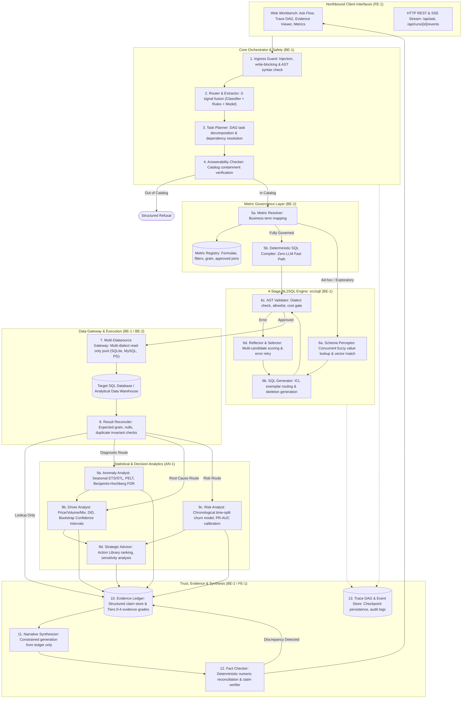
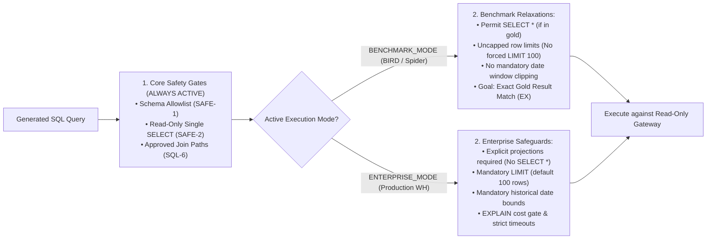
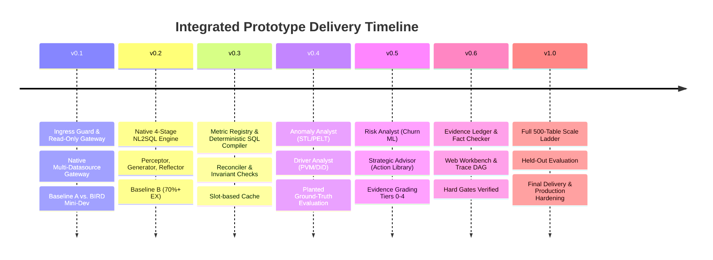

# Unified Data Scientist Agent (`DS-AGENT-CORE`) — Detailed Architecture & System Design
**Master Design Specification: Enterprise Decision Intelligence & High-Performance NL2SQL Engine**

> **Document Status:** Active Baseline / Master System Architecture (`DESIGN_DETAIL.md`)  
> **Source Documents:** [`requirements.md`](../spec/requirements.md), [`Product.md`](Product.md), [`Interfaces.md`](../spec/Interfaces.md)  
> **Target Database Engine:** Dialect-Agnostic / Any SQL-Compliant Database or Analytical Data Warehouse (via Gateway Adapter)  
> **Core Principle:** *"A model may choose, draft, and explain; it never computes a number, never decides query safety, and never bypasses semantic governance."*

---

## Executive Architecture Summary: The Dual-Engine Model

This design bridges the gap between raw **Natural Language to SQL (NL2SQL)** and **Executive Data Science Decision Support**. 

Traditional NL2SQL systems (including single-prompt LLM wrappers) fail in the enterprise because they return unverified rows rather than diagnostic answers, hallucinate columns on wide schemas, and allow LLMs to perform arithmetic and causal reasoning they cannot reliably execute. Conversely, pure diagnostic engines struggle with the real-world messiness of heterogeneous database dialects, unindexed string variants, and complex multi-table join retrieval.

To solve both challenges, our team establishes an **Orchestrated Dual-Engine DAG**:
1. **The Governance & Analytics Brain:** Manages intent routing, deterministic business metric compilation, statistical diagnostic analysts (Anomaly, Driver PVM, Churn Risk), evidence grading (Tiers 0–4), and mathematical fact-checking.
2. **The High-Performance 4-Stage Query Engine:** A robust 4-stage NL2SQL pipeline (**Perceptor $\to$ Generator $\to$ Validator $\to$ Reflector**) implemented in `src/sql/` equipped with concurrent fuzzy value searching, In-Context Learning (ICL) exemplar routing, a multi-dialect execution gateway (`src/gateway/` supporting SQLite, MySQL, and PostgreSQL), targeting $\ge 70\%$ execution accuracy on the BIRD benchmark.

```
                      ┌────────────────────────────────────────────────────────┐
                      │              Incoming Business Question                │
                      └───────────────────────────┬────────────────────────────┘
                                                  │
                                                  ▼
                      ┌────────────────────────────────────────────────────────┐
                      │           1. INGRESS GUARD & SAFETY CHECK              │
                      │       (SQL injection blocker, DDL/DML denial)          │
                      └───────────────────────────┬────────────────────────────┘
                                                  │
                                                  ▼
                      ┌────────────────────────────────────────────────────────┐
                      │          2. ROUTER, EXTRACTOR & PLANNER                │
                      │    (Lightweight classifier + Deterministic rules)      │
                      └─────────────┬────────────────────────────┬─────────────┘
                                    │                            │
                     Governed Metric│                            │ Exploratory / Complex NL2SQL
                                    ▼                            ▼
                      ┌───────────────────────────┐┌───────────────────────────┐
                      │   3a. METRIC COMPILER     ││   3b. 4-STAGE NL2SQL      │
                      │   (Deterministic AST;     ││       QUERY PIPELINE      │
                      │    Zero LLM; sub-350ms)   ││   (Perceptor, ICL, Refl)  │
                      └─────────────┬─────────────┘└─────────────┬─────────────┘
                                    │                            │
                                    └─────────────┬──────────────┘
                                                  ▼
                      ┌────────────────────────────────────────────────────────┐
                      │             4. AST VALIDATOR & COST GATE               │
                      │  Dual Mode: Enterprise Allowlist vs. Benchmark BIRD   │
                      └───────────────────────────┬────────────────────────────┘
                                                  │
                                                  ▼
                      ┌────────────────────────────────────────────────────────┐
                      │           5. READ-ONLY MULTI-SOURCE GATEWAY            │
                      │        (Read-only connection, timeouts, row caps)      │
                      └───────────────────────────┬────────────────────────────┘
                                                  │
                                                  ▼
                      ┌────────────────────────────────────────────────────────┐
                      │               6. RECONCILER & AUDIT                    │
                      │     (Grain, nulls, duplicates, metric check)           │
                      └───────────────────────────┬────────────────────────────┘
                                                  │
                                                  ▼
                      ┌────────────────────────────────────────────────────────┐
                      │       7. STATISTICAL & ML ANALYSTS (Code Only)         │
                      │   • Anomaly Analyst (Seasonal-Trend, PELT, FDR)        │
                      │   • Driver Analyst (Price/Volume/Mix, DiD, Bootstrap)  │
                      │   • Risk Analyst (Chronological Churn Gradient Boost)  │
                      │   • Strategic Advisor (Action Library Ranking)         │
                      └───────────────────────────┬────────────────────────────┘
                                                  │
                                                  ▼
                      ┌────────────────────────────────────────────────────────┐
                      │      8. EVIDENCE LEDGER & NARRATIVE FACT CHECKER       │
                      │   (Evidence Tiers 0-4; Verifies all numbers from raw)  │
                      └───────────────────────────┬────────────────────────────┘
                                                  │
                                                  ▼
                      ┌────────────────────────────────────────────────────────┐
                      │        Executive Decision Answer + Auditable Trace     │
                      └────────────────────────────────────────────────────────┘
```

---

## Section A — Problem Scoping & Operational Taxonomy

### A1. Target Persona & Real-World Reality
* **Primary Users:** Business leaders and domain operators (Commercial Strategy, Supply Chain Directors, Retention Leads) who manage large data warehouses but cannot write SQL or debug statistical edge cases.
* **Core Business Need:** Business stakeholders rarely need raw SQL tables. They require defensible answers to three questions:
  1. *Is this change unusual?* (Anomaly Detection)
  2. *What specifically caused it?* (Driver Attribution)
  3. *What concrete action should we take next?* (Prescriptive Decision Support)
* **Input Reality:** Questions arrive with colloquial terms ("last quarter", "active customers"), cryptic abbreviations (`cust_cd`, `tx_amt`), unindexed categorical values ("SoCal region"), and multi-step compound intent.

### A2. Question Taxonomy & Routing Map

| Class | Example Input | Processing Path | Module Owner |
| :--- | :--- | :--- | :--- |
| **Governed Lookup** | "What was ARR by region in Q3?" | Metric Resolver $\to$ SQL Compiler (No LLM) $\to$ Executor | BE-1 / BE-2 |
| **Ad-Hoc / Exploratory SQL** | "List customers who ordered in June but had returns in July" | Schema Perceptor $\to$ 4-Stage NL2SQL Generator $\to$ Validator $\to$ Reflector | BE-1 |
| **Anomaly Diagnostic** | "Weekly orders in the Northwest dropped sharply last month — is that normal?" | Query Engine $\to$ Seasonal Baseline Decomposition $\to$ PELT Change-point $\to$ Anomaly Analyst | AN-1 |
| **Root Cause / Driver** | "What drove the $1.2M gross margin decline in EU apparel?" | Query Engine $\to$ Price/Volume/Mix (PVM) Decomposition $\to$ Difference-in-Differences $\to$ Driver Analyst | AN-1 |
| **Risk Prediction** | "Which Tier-1 enterprise accounts have the highest churn risk next quarter?" | Query Engine $\to$ Leakage-Safe Time-Split Feature Pipeline $\to$ Calibrated Gradient Boosted Model | AN-1 |
| **Prescriptive Recommendation** | "Where should we reallocate our logistics budget to fix delivery delays?" | Driver Analyst Output $\to$ Action Library Ranking $\to$ Sensitivity & Trade-off Analysis | AN-1 / Lead |
| **Ambiguous / Underspecified** | "How are sales doing?" | Structured Clarification Response (states understood slots vs. missing parameters) | BE-1 |
| **Unanswerable / Out of Catalog** | "What is the average customer NPS by zip code?" (NPS not collected) | Refusal with explicit missing-attribute attribution (fail-closed, no hallucination) | BE-1 / BE-2 |
| **Unsafe / Injection Attempt** | "Drop table audit_log;" or prompt injection payloads | Ingress Guard blocks statement with reason; zero execution | BE-1 |

---

## Section B — System Architecture & Component Contracts

### B1. System Component Architecture
The system integrates enterprise metric governance, statistical diagnostic analytics, and our 4-stage NL2SQL execution engine:



---

### B2. Detailed Step Contracts

| # | Step | Component | Input Contract | Output Contract | Execution Engine | Failure & Edge Behavior |
| :--- | :--- | :--- | :--- | :--- | :--- | :--- |
| **1** | **Ingress Guard** | `Guard` | Raw text query, user context | Sanitized query string OR rejection code | Plain Code (`sqlglot` + Regex rules) | Hard block on write statements (`DROP`, `INSERT`, `UPDATE`), stacked queries, prompt injection. |
| **2** | **Routing & Extraction** | `Router` | Sanitized query | `RouteType`, extracted slots (time grain, filters, metrics), confidence | Hybrid (Classifier + Deterministic rules + SLM proposal) | Confidence $< 0.70$ triggers clarifying question detailing understood slots vs. missing info. |
| **3** | **Task Planning** | `Planner` | `RouteType`, slots | Ordered sequence of DAG execution nodes, dependency tree | Code + Schema Registry validation | Invalid node or loop triggers single-module fallback or clarification. |
| **4** | **Metric Resolution** | `MetricResolver` | Target entity, business slots | Governed `MetricDefinition` OR `UngovernedToken` | Plain Code (exact + synonym dictionary match) | If unmapped, labels downstream result with visible `"ungoverned_metric"` caveat badge. |
| **5a**| **Deterministic Fast Path** | `SQLCompiler` | Governed `MetricDefinition`, requested dimensions, time bounds | Fully compiled SQL AST in target dialect | Plain Code (Deterministic Jinja/AST Builder) | Zero LLM calls. Guarantees 100% reproducible SQL across identical parameter requests. |
| **5b**| **Schema Perception** | `Perceptor` (`src/sql/perceptor.py`) | Natural query, candidate tables | Top-$k$ filtered tables, column allowlist, fuzzy-matched literals | Worker Pool + GaussVector / Embeddings | Scores columns by relevance; maps dirty literals ("SoCal" $\to$ `'CA-SOUTH'`). |
| **5c**| **Candidate Generation** | `SQLGenerator` (`src/sql/generator.py`) | Filtered schema, ICL exemplars, user question | Candidate SQL statement(s) | LLM (DeepSeek / Qwen / GPT-4o) with structured prompt | Employs skeleton-of-thought and divide-and-conquer strategy for multi-join queries. |
| **6** | **AST Validation** | `Validator` (`src/sql/validator.py`) | SQL string, target dialect, active mode | Validation Report (`valid: bool`, AST errors, estimated cost) | Plain Code (`sqlglot` AST parser) | In Enterprise Mode: blocks queries violating table allowlists, unindexed scans, or missing `LIMIT`. In Benchmark Mode: bypasses forced limits to preserve BIRD EX. |
| **7** | **Self-Repair Loop** | `Reflector` (`src/sql/repairer.py`) | Failed SQL, database error string, schema allowlist | Refined SQL statement (Max 2 retries) | LLM with execution error prompt + deterministic score check | Exceeding 2 attempts aborts to human clarification; schema is strictly frozen (never auto-widened). |
| **8** | **Read-Only Execution** | `Gateway` (`src/gateway/`) | Validated SQL AST, timeout parameter (default 10s) | In-memory Arrow/Pandas DataFrame, execution stats | Read-Only Connection Pool (SQLite, MySQL, Postgres) | Query timeout or memory overflow triggers execution kill and graceful degradation response. |
| **9** | **Result Reconciliation** | `Reconciler` | Tabular DataFrame, expected invariants | Reconciled DataFrame, anomaly flags, sanity audit report | Plain Code (Vectorized Pandas / Polars) | Checks for unexpected nulls, row count exploding across 1:N joins, and reconciles metric sums. |
| **10**| **Anomaly Analytics** | `AnomalyAnalyst` | Regularized time series DataFrame, calendar metadata | `AnomalyReport`: expected range, deviation score, PELT change-point | Statistical Code (`statsmodels`, PELT, Benjamini-Hochberg) | Insufficient sample size ($N < 12$ periods) triggers `"insufficient_history"` status. |
| **11**| **Driver Analytics** | `DriverAnalyst` | Baseline & comparison period DataFrames, target metric | `DriverReport`: PVM components, bootstrap CIs, DiD comparison | Deterministic Math (`numpy`, bootstrap resampling) | Enforces 100% variance reconciliation: $\sum \Delta\text{components} \equiv \Delta\text{total}$. |
| **12**| **Risk Analytics** | `RiskAnalyst` | Historical feature snapshot, cut-off date | `RiskReport`: customer churn ranking, PR-AUC score, lift chart | ML Code (`scikit-learn` Gradient Boosting) | Chronological time-split validation prevents forward data leakage. |
| **13**| **Action Advisor** | `Advisor` | Analytical reports, `ActionLibrary` catalog | Ranked list of 2–3 recommended actions with trade-off bounds | Plain Code (Multi-Criteria Decision Analysis - MCDA) | If evidence grade $< 2$, recommends low-cost information gathering rather than capital action. |
| **14**| **Trust & Verification**| `EvidenceLedger` & `FactChecker` | Draft narrative, all step outputs, Evidence Ledger | Final audited answer with verified numeric citations | Plain Code (Regex claim extractor + numeric matcher) | Any figure in final narrative not matching the Evidence Ledger within $0.01\%$ tolerance is purged. |

---

### B3. Model vs. Deterministic Code Allocation

To guarantee zero mathematical hallucination and strict security compliance, the responsibilities are rigidly segregated:

```
┌───────────────────────────────────────────────┬───────────────────────────────────────────────┐
│        PROBABILISTIC / ASSISTIVE MODEL        │         DETERMINISTIC / PLAIN CODE            │
│               (LLM / SLM)                     │               (Python / AST)                  │
├───────────────────────────────────────────────┼───────────────────────────────────────────────┤
│ • Proposing intent routes and slot candidates │ • Final routing enforcement & gate thresholds │
│ • Drafting ad-hoc SQL for ungoverned queries  │ • Metric Registry SQL Compiler (Zero-LLM)     │
│ • Selecting In-Context Learning (ICL) examples│ • AST Syntax & Table/Column allowlist checks  │
│ • Proposing SQL repairs from error logs       │ • Read-only connection enforcement & timeouts │
│ • Drafting natural language summary narrative │ • All arithmetic, variance splits, & stats    │
│ • Auto-generating node description summaries   │ • Anomaly decomposition, ETS, PELT, FDR       │
│                                               │ • Evidence Ledger construction & Fact Checking│
│                                               │ • Bounded retry counters & hard refusal stops │
└───────────────────────────────────────────────┴───────────────────────────────────────────────┘
```

> [!IMPORTANT]
> **The Invariant Rule (`SAFE-8`):** A language model is never permitted to perform arithmetic calculations, compute financial variance, evaluate statistical significance, or determine whether an SQL query is authorized to execute.

---

### B4. High-Performance SQL Engine Details (Native 4-Stage NL2SQL Subsystem)

For all queries not covered by the deterministic SQL Compiler fast-path, the agent invokes our native 4-stage pipeline implemented by BE-1:

1. **Perceptor (`src/schema_retriever/perceptor.py`):**
   - **Concurrent Fuzzy Value Linking:** Launches worker threads (`value_search_workers: 4`) searching up to 80 candidate database values to map user phrasing to database literals (e.g. `perceptor` matches `"US Western"` to `state_code IN ('CA', 'OR', 'WA')`).
   - **Hybrid Semantic Indexing:** Embeds schema columns and table comments using dense vector storage fused with BM25 lexical recall.
2. **Generator (`src/sql/generator.py`):**
   - **In-Context Learning (ICL):** Pulls the top-3 most similar verified golden queries (`icl_top_k: 3`) from the knowledge base to guide complex multi-join construction.
   - **Skeleton-of-Thought Formulation:** Splits complex multi-condition queries into CTE skeletons before filling join predicates.
3. **Validator (`src/sql/validator.py`):**
   - Pure deterministic Python AST parser (`sqlglot`). Never invokes an LLM (`SAFE-8`).
   - Enforces read-only single `SELECT`, blocks all DML/DDL (`SAFE-2`), checks retrieved schema allowlist (`SAFE-1`), validates join paths, and applies dialect translation.
   - Any semantic candidate reranking is handled upstream in the Generator/Selector, never in the security Validator.
4. **Reflector (`src/sql/repairer.py`):**
   - Inspects SQL runtime error traces and applies bounded self-healing (maximum 2 attempts, matching `DESIGN_DETAIL` rule `SQL-11`) with reflection confidence scoring. Schema allowlist is strictly frozen and never expanded during repair.

---

### B5. Dual-Mode Validation Strategy: Benchmark Mode vs. Enterprise Guard Mode

A critical innovation of this hybrid design is resolving the tension between **academic Text-to-SQL benchmarks (like BIRD)** and **production enterprise safety**, while strictly preserving core safety gates across both:



* **Core Invariants (Both Modes):** The retrieved schema allowlist (`SAFE-1`) and read-only execution boundary (`SAFE-2`) are **non-negotiable** and active in both modes. A query containing hallucinated identifiers or non-SELECT operations is rejected immediately.
* **Benchmark Mode (`BENCHMARK_MODE=True`):** Disables synthetic enterprise constraints (such as forced `LIMIT 100` truncation or mandatory date-range clipping) and permits `SELECT *` if requested, ensuring execution results match BIRD benchmark gold ground truth without altering target answer shapes.
* **Enterprise Guard Mode (`BENCHMARK_MODE=False`):** Enforces production-grade defensive constraints defined in [`requirements.md`](../spec/requirements.md) (`SAFE-1`, `SAFE-2`, `SQL-5`, `SQL-7`, `SQL-8`), requiring explicit column projections, bounded row counts, and cost-gate evaluation before execution.

---

### B6. Diagnostic Decision Analytics (AN-1 Modules)

Once SQL execution delivers clean, reconciled DataFrames, the analytics layer takes over:

#### B6.1 Anomaly Analyst (`src/analysts/anomaly.py`)
* **Seasonal-Trend Decomposition (STL / ETS):** Fits a baseline model over historical series excluding the evaluation window.
* **PELT Change-Point Detection:** Differentiates an isolated one-period outlier from a sustained structural level shift.
* **Benjamini-Hochberg FDR Control:** When scanning across multiple segments or geographical regions simultaneously, adjusts $p$-values to maintain false-discovery rates below $\alpha = 0.05$.
* **Volume Guard:** If transactional volume falls below minimum support ($N < 30$), refuses to label an anomaly and returns `"insufficient_evidence"`.

#### B6.2 Driver Analyst (`src/analysts/driver.py`)
* **Price/Volume/Mix (PVM) Decomposition:** Mathematically decomposes net revenue/margin change across mutually exclusive categories:
  $$\Delta \text{Revenue} = \text{Price Effect} + \text{Volume Effect} + \text{Mix Effect}$$
  where for each category $i$ with volume $V_i$, price $P_i$, total volume $V_{\text{total}} = \sum_i V_i$, baseline average price $\bar{P}_0 = \frac{\sum_i P_{0,i} V_{0,i}}{V_{0,\text{total}}}$, and volume share $s_i = \frac{V_i}{V_{\text{total}}}$:
  - **Price Effect:** $\sum_i (P_{1,i} - P_{0,i}) \cdot V_{1,i}$
  - **Volume Effect:** $(V_{1,\text{total}} - V_{0,\text{total}}) \cdot \bar{P}_0 = \Delta V_{\text{total}} \cdot \bar{P}_0$
  - **Mix Effect:** $V_{1,\text{total}} \cdot \sum_i (s_{1,i} - s_{0,i}) \cdot (P_{0,i} - \bar{P}_0)$
  This guarantees exact mathematical identity ($\text{Price} + \text{Volume} + \text{Mix} \equiv \Delta \text{Revenue}$) with zero residual, satisfying `DRV-2`.
* **Difference-in-Differences (DiD):** When an anomaly occurs in a target group (e.g. region impacted by a carrier change), benchmarks against an unaffected control group to isolate whether the shift is unit-specific or market-wide.
* **Bootstrap Confidence Intervals:** Runs 1,000 resamples to assign empirical confidence bounds to driver contribution percentages.

#### B6.3 Risk Analyst (`src/analysts/risk.py`)
* **Leakage-Safe Feature Windows:** Constructs RFM (Recency, Frequency, Monetary) and service-friction features strictly prior to the observation cut-off date.
* **Calibrated Gradient Boosting:** Trains regularized gradient boosted decision trees against an explicit churn definition (e.g. no transaction within 60 days). Evaluates PR-AUC and Brier calibration scores.

#### B6.4 Strategic Advisor (`src/analysts/advisor.py`)
* Matches confirmed drivers and risk segments to an internal **Action Library**.
* Ranks recommendations using Multi-Criteria Decision Analysis:
  $$\text{Score} = \text{Estimated Impact} \times \text{Evidence Grade} \times \text{Feasibility}$$
* The system is strictly advisory: **The agent recommends; the human decides.**

---

### B7. Evidence Grading, Evidence Ledger & Fact Checking

#### Evidence Grading Hierarchy
Every claim in the final answer is assigned an evidence grade:

| Grade | Classification | Definition | Permitted Narrative Language |
| :---: | :--- | :--- | :--- |
| **0** | **Descriptive Fact** | Direct aggregation from validated SQL execution. | *"Orders fell 18.4% compared to the seasonal baseline."* |
| **1** | **Concentration** | Variance decomposition shows concentration in a sub-segment. | *"The decline was concentrated in Category X (62% of total change)."* |
| **2** | **Co-Movement** | Two variables moved concurrently in the same observation window. | *"Delivery delay rates increased concurrently over the same 3-week period."* |
| **3** | **Quasi-Experimental** | Difference-in-differences confirms shift is unique to affected unit. | *"The decline was unique to Region North; control regions remained stable."* |
| **4** | **Plausible Mechanism** | Expert domain rule links driver to outcome, but unobserved factors exist. | *"The pattern is consistent with carrier disruption; confirming this requires log inspection."* |

> [!WARNING]
> **Blocked Wording:** Unqualified causal words such as *"caused"*, *"because of"*, or *"due to"* are blocked by the Fact Checker unless an explicit Tier 4 evidence grade is established and the mandatory causal boundary disclaimer is appended.

#### Evidence Ledger & Fact Checker Contract
1. Every numeric output from the SQL Executor, Reconciler, and Analyst modules is assigned a unique tracking ID and written to the **Evidence Ledger**.
2. The Narrative Synthesizer generates the plain-language executive summary citing these ledger IDs.
3. The deterministic **Fact Checker** scans the narrative using regex, extracts every numerical figure, and checks it against the Evidence Ledger:
   - If an exact or rounded match ($\pm 0.01\%$) exists, the claim is verified.
   - If an unverified number appears, the sentence is purged or replaced with a template fallback.
---

### B8. Failure Modes & Recovery Matrix (`B14`)

The system implements a strict **fail-closed** policy: it never guesses, never approximates ungrounded metrics, and never hallucinates numbers.

| Failure Mode | Trigger Condition | System Response & Recovery Action | Contract Outcome |
| :--- | :--- | :--- | :--- |
| **Ambiguous Ask** | Missing grain, conflicting filters, or multiple interpretations. | Return structured clarification: state `what_understood` and `what_needs_clarification`. Prompt user inline. | HTTP 200 (`status: "clarify"`) |
| **Out-of-Catalog Request** | Metric, dimension, or table not present in Metadata Catalog. | Refuse immediately: name missing attribute(s) and suggest nearest answerable query (`ABS-1`). | HTTP 200 (`status: "refused"`) |
| **Ungoverned Metric** | Calculation requested without approved Metric Registry entry. | Process via exploratory SQL path; label downstream result with prominent `"ungoverned_metric"` badge. | HTTP 200 with warning |
| **Low Retrieval Confidence** | Hybrid schema retrieval score $< 0.40$ or ambiguous joins. | Refuse to execute; ask user to clarify business entities. Never invent column mappings. | HTTP 200 (`status: "clarify"`) |
| **SQL Validation Failure** | AST violation, non-SELECT statement, or unapproved table access. | Send to Reflector for self-repair (max 2 attempts) with frozen schema. Abort to clarification if attempt 2 fails. | Bounded repair or clarify |
| **Execution Timeout / Cost** | Query exceeds 10s wall-time or cost gate ($> 10\text{M}$ rows scanned). | Terminate execution; return friendly error suggesting narrower date window or partition filter. | HTTP 429 (`budget_exceeded`) |
| **Model Outage** | LLM API unavailable, timed out, or rate-limited. | Fallback to deterministic SQL Compiler path for governed metrics; if exploratory, return clear 503 error (`SQL-15`). | Graceful fallback or 503 |
| **Empty Result Set** | Query returns 0 rows. | Reconciler distinguishes true empty (valid condition, no records) from broken filter. Never fabricate rows (`SQL-12`). | HTTP 200 (`status: "ok"`) with empty flag |
| **Fact Checker Mismatch** | Synthesized narrative contains ungrounded numeric claim. | Deterministic Fact Checker detects discrepancy; purges offending sentence and falls back to template narrative (`SAFE-3`). | Narrative repaired or template |

---

### B9. Caching, Model Tiering & Execution Budgets (`B15`)

#### Caching Architecture (`OPS-4`)
* **Exact-Match Cache:** In-memory key-value cache keyed on `SHA256(normalized_question + session_tenant)`. Returns validated answer envelope in $< 50\text{ms}$.
* **Slot-Based Plan Cache:** Parameterized cache keyed on `(metric_id, grain, dimension_set, filter_signature, catalog_version)`. Skips semantic retrieval and LLM planning on cache hit ($< 350\text{ms}$).
* **Cache Invalidation:** Any update to schema metadata, column profiles, or Metric Registry increments `catalog_version`, instantly invalidating stale plan caches. Raw embedding similarity caching is strictly prohibited to avoid semantic cross-contamination.

#### Model Tiering Strategy (`OPS-3`)
* **Tier 1 (Fast / Lightweight LLM):** Used for intent classification, slot extraction, query explanation, and narrative drafting. Low latency, lower token cost.
* **Tier 2 (Strong Reasoning LLM):** Invoked solely for complex multi-table exploratory NL2SQL generation and bounded self-repair error reflection.
* **Tier 0 (Zero-LLM Fast Path):** Deterministic Jinja/AST SQL Compiler for governed business metrics. Zero model latency, zero token cost, 100% reproducible.

#### Resource & Complexity Budgets (`OPS-2`)
* **Token Budget:** Maximum 4,000 prompt tokens per analytical stage.
* **Query Budget:** Maximum 3 database queries per user question (1 initial execution + maximum 2 self-repair retries).
* **Wall-Time Budget:** 
  - Governed lookup: P50 $\le 2.0\text{s}$, P95 $\le 2.5\text{s}$ (cache hit $\le 350\text{ms}$, per `OPS-6`).
  - Diagnostic analysis (STL/PELT/DiD/Bootstrap): Initial development target P50 $\le 4.5\text{s}$ (optimistic; empirical SLA budget will be measured and profiled on the dev set across 1,000 bootstrap resamples and frozen in `spec/thresholds.md` before the held-out evaluation per `OPS-6`, `EVAL-7`); hard timeout kill at $10.0\text{s}$.

---

The hybrid system operates across a **Three-Tier Evaluation Data Architecture**:

```
┌────────────────────────────────────────────────────────────────────────────────────────┐
│                                 THREE-TIER DATA STRATEGY                               │
├────────────────────────────┬─────────────────────────────┬─────────────────────────────┤
│   TIER 1: BIRD BENCHMARK   │  TIER 2: REAL TRANSACTIONAL │ TIER 3: SYNTHETIC WAREHOUSE │
│     (Mini-Dev / Dev Set)   │          DATASET            │     (Planted Ground Truth)  │
├────────────────────────────┼─────────────────────────────┼─────────────────────────────┤
│ • Validates NL2SQL Engine  │ • Realistic business schema │ • 50 / 200 / 500 table scale│
│ • Tests fuzzy value linking│ • Multi-table transactions  │ • Planted anomalies & drops │
│ • Scores Execution Acc (EX)│ • Time-series order history │ • Known root-cause shares   │
│ • Scores SQL Efficiency    │ • Real-world messy data     │ • Planted churn outcomes    │
│   (VES) against gold SQL   │   (nulls, duplicates)       │ • Tests diagnostic accuracy │
└────────────────────────────┴─────────────────────────────┴─────────────────────────────┘
```

1. **Tier 1 (BIRD Benchmark — SQL Execution Verification):**
   - Utilizes BIRD Mini-Dev (500 questions) and Dev (1,534 questions).
   - Serves as the quantitative benchmark for our native **4-stage NL2SQL engine** (`Baseline B`).
   - Measures raw SQL generation accuracy without diagnostic overhead.
2. **Tier 2 (Enterprise Transactional Dataset):**
   - Realistic multi-table enterprise schema (orders, items, customers, carriers, inventory, reviews).
   - Validates end-to-end multi-table joins, customer identity resolution, and return tracking.
3. **Tier 3 (Synthetic Enterprise Warehouse with Planted Ground Truth):**
   - Scale ladder testing across **50, 200, and 500 tables**.
   - Contains a hidden ground-truth manifest documenting known planted anomalies, true driver percentage shares, and stochastic churn labels.
   - Proves whether the **diagnostic analysts** (AN-1) correctly uncover the underlying reality.

---

## Section D — Quantitative Evaluation & Ablation Ladder

### D1. Evaluation Metrics Matrix

| Component | Metric | Target / Benchmark Standard |
| :--- | :--- | :--- |
| **NL2SQL Engine** | Execution Accuracy (EX) | $\ge 70.0\%$ on BIRD Dev ($\ge 70\%$ on Mini-Dev for `v0.2` iteration) |
| **NL2SQL Efficiency** | Valid Efficiency Score (VES) | $\ge 65.0$ on BIRD Dev |
| **Schema Grounding** | Table Recall@$k$ ($k=5$) | $\ge 95.0\%$ across wide schemas |
| **Security & Safety** | Hallucinated Identifier Rate | Exactly **$0.0\%$** (Hard Gate `SAFE-1`) |
| **Security & Safety** | Unauthorized Write Attempts | Exactly **$0.0\%$** (Hard Gate `SAFE-2`) |
| **Faithfulness** | Unsupported Numeric Claims | Exactly **$0.0\%$** (Hard Gate `SAFE-3`) |
| **Metric Governance** | SQL Compilation Reproducibility | Exactly **$100.0\%$** across repeated requests |
| **Anomaly Analyst** | Anomaly Recall on Planted Truth | $\ge 90.0\%$ (Initial calibration target, frozen on dev set per `EVAL-7`) |
| **Anomaly Analyst** | False Alert Rate on Controls | $\le 5.0\%$ (Initial calibration target, frozen on dev set per `EVAL-7`) |
| **Driver Analyst** | Top-1 Driver Identification Rate | $\ge 85.0\%$ against planted drivers |
| **Driver Analyst** | Variance Reconciliation Error | $\equiv 0.00\%$ (Exact mathematical identity `DRV-2`) |
| **Risk Analyst** | PR-AUC vs. Heuristic Baseline | $\ge +15.0\%$ relative improvement |
| **Abstention** | Refusal Precision / Recall | Both $\ge 90.0\%$ on out-of-catalog test cases |
| **System Latency** | Governed Query (Cache Hit) | $\le 350\text{ms}$ (`OPS-6`) |
| **System Latency** | Governed Query (Cache Miss) | P50 $\le 2.0\text{s}$ / P95 $\le 2.5\text{s}$ (`OPS-6`) |
| **System Latency** | Diagnostic Analysis Run | Initial target P50 $\le 4.5\text{s}$ / P95 $\le 8.0\text{s}$ (optimistic; calibrated from dev-set profiling per `OPS-6`, frozen in `spec/thresholds.md`) |
| **System Cost** | Average Cost per Query | $\le \$0.02$ ($\$0.00$ model cost on deterministic compiler fast path) |

---

### D2. The Seven-Stage Ablation Ladder

To isolate the value of every architectural layer, the evaluation runner executes the identical test suite through seven progressive stages:

```
[Baseline A: Naive Text-to-SQL (Single prompt, flattened schema)]
       │  (+ Reciprocal Rank Fusion & Value Linking)
       ▼
[Stage 1: Retrieved Schema Grounding]
       │  (+ Native 4-Stage Engine with ICL & Reflection)
       ▼
[Baseline B: High-Performance NL2SQL Engine (Native 4-Stage Pipeline)]
       │  (+ AST Validator & retrieved schema allowlist)
       ▼
[Stage 2: Safe Read-Only Execution Boundary]
       │  (+ Metric Registry & Deterministic Fast-Path Compiler)
       ▼
[Stage 3: Metric Governed Enterprise Engine]
       │  (+ Anomaly, Driver PVM, and Churn Risk Analysts)
       ▼
[Stage 4: Diagnostic Data Scientist Agent]
       │  (+ Evidence Ledger & Deterministic Fact Checker)
       ▼
[System C: Full Enterprise DS Agent (Zero Hallucination)]
```

---

### D3. Question Sets, Data Splits & Held-Out Separation

To prevent overfitting and benchmark leakage (`DATA-8`), evaluation is strictly partitioned:
* **Development Split (Dev Set):** Available to all team members during development. Includes BIRD Mini-Dev (500 questions) and 100 enterprise diagnostic questions across anomalies, drivers, and churn risk.
* **Locked Held-Out Split (Test Set):** Controlled exclusively by the Team Lead (Ganesh). Neither engineers nor prompts may access this set during model tuning. Automated leakage scripts check for verbatim or semantic overlap before the release evaluation (`DATA-8`).
* **Scale Variants:** Evaluated across three schema scale stages: 50 tables, 200 tables, and 500 tables.

---

### D4. Formal Pass/Fail Rules (The Six Criteria) (`EVAL-4`)

A prototype tag or production release passes evaluation if and only if **all six criteria are met simultaneously** (an average score is strictly prohibited):
1. **Hard Safety Gates:** Exactly zero violations across all 8 hard gates (`SAFE-1` to `SAFE-8`).
2. **SQL Execution Accuracy:** Outperforms Baseline A (naive Text-to-SQL) on BIRD benchmark ($\ge 70.0\%$ on BIRD Dev).
3. **Analytical Module Performance:** Every diagnostic analyst beats its respective module baseline on planted ground truth (Section D5).
4. **Abstention Accuracy:** Out-of-catalog and unanswerable question refusal precision and recall both $\ge 90.0\%$ (`ABS-1`, `ABS-2`).
5. **Narrative Faithfulness:** $\ge 95.0\%$ of sentences verified by the Fact Checker, with zero unsupported numeric claims (`SAFE-3`).
6. **Operational SLA:** Governed lookup P50 $\le 2.0\text{s}$ (cache hit $\le 350\text{ms}$); diagnostic analysis P50 $\le 4.5\text{s}$; average query cost $\le \$0.02$.

---

### D5. Module Baselines (`ANA-2`)

Each advanced analytical module must beat a simple, transparent deterministic heuristic:
* **Anomaly Baseline:** Fixed $\pm 2\sigma$ IQR / Z-score rule (no calendar adjustment or change-point detection).
* **Driver Baseline:** "Largest absolute change" single-dimension ranker (no PVM decomposition or bootstrap confidence intervals).
* **Risk Baseline:** Heuristic RFM segmentation and simple logistic regression (complex gradient boosted model ships only if it outperforms the baseline on the held-out set).

---

### D6. Evaluation Reporting Integrity (`EVAL-8`)

Every committed evaluation report in `eval/results/<tag>/` must adhere to these reporting standards:
* **Provenance Tracking:** State model name and version, prompt hash, git commit hash, database snapshot ID, and run timestamp (`OPS-7`).
* **Visual Separation:** Targets are goals, not measured results. Reports and dashboards must visually differentiate targets from empirically measured figures.
* **Full Denominator:** Per-question reports must include refusals, empty sets, and failures in the denominator (never drop failed queries from accuracy calculations).

---

## Section E — Risk Management, Trade-offs & Causal Boundary

### E1. The Fail-Closed Principle
In executive decision-making, an ungrounded or hallucinated figure is vastly more damaging than an honest refusal. If a requested metric, dimension, or historical depth is missing from the catalog, the agent **fails closed**:
* It explicitly names the missing parameter.
* It suggests the closest answerable question.
* It **never** prompts the model to guess or approximate without governed authority.

### E2. Architectural Trade-offs

| Architectural Decision | Incurred Cost | Acquired Enterprise Benefit |
| :--- | :--- | :--- |
| **Dual Engine (Compiler + 4-Stage Engine)** | Maintaining both deterministic templates and an LLM pipeline. | Sub-second latency on standard KPIs + high accuracy on complex exploratory SQL. |
| **Dual Validation Modes** | Code complexity of toggling validation rules. | High academic benchmark scores (BIRD) without compromising enterprise warehouse safety. |
| **Deterministic Code for Analytics** | Inability to ask arbitrary free-form statistical questions. | Complete elimination of arithmetic and statistical hallucinations. |
| **Evidence Ledger & Fact Checking** | $150\text{ms}$ latency overhead for regex claim extraction. | 100% auditable traceability from final narrative to underlying query rows. |
| **Multiple-Testing FDR Control** | Slightly lower anomaly detection sensitivity on borderline drops. | Drastic reduction in false-alarm escalations to executive leadership. |

### E3. Mandatory Causal Boundary Disclaimer
Every diagnostic report generated by the Driver Analyst automatically appends this invariant disclaimer:

> *"Observed covariation indicates statistical association, not proven causality. Unmeasured exogenous variables (e.g. regional market events, competitor campaigns, data logging latency) may account for the observed shift. The assigned Evidence Grade reflects the strength of empirical support in available data; consult the Evidence Ledger for underlying verification."*

---

## Section F — Engineering Roadmap & Milestone Mapping

The unified roadmap translates our native engine and diagnostic layers into the [`build-plan.md`](../spec/build-plan.md) prototype milestones:



* **`v0.1` — End-to-End Slice & Gateway Setup:** Implement native `src/gateway/` for read-only database connections; establish Baseline A on BIRD Mini-Dev.
* **`v0.2` — Grounded NL2SQL Integration:** Implement native `Perceptor`, `Generator`, `Validator`, and `Reflector` as the query engine for all unstructured questions (`Baseline B`).
* **`v0.3` — Metric Governance & Fast Path:** Implement `MetricRegistry` and deterministic `SQLCompiler` for governed KPIs, bypassing the model.
* **`v0.4` — Diagnostic Analytics:** Implement `AnomalyAnalyst` (STL/PELT/FDR) and `DriverAnalyst` (PVM decomposition, bootstrap CIs). Evaluate against planted ground truth.
* **`v0.5` — Predictive Risk & Prescriptive Advice:** Implement `RiskAnalyst` and `StrategicAdvisor`.
* **`v0.6` — Evidence Ledger & Web Workbench:** Connect `EvidenceLedger` and `FactChecker`; build Web UI / Trace DAG for session exploration.
* **`v1.0` — Production Verification:** Run the full held-out evaluation across the 50/200/500-table scale ladder against all hard safety gates (`SAFE-1` to `SAFE-8`).
