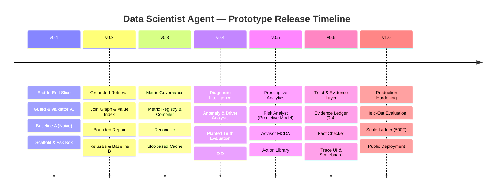

# Build Plan — Data Scientist Agent
**Engineering Execution Roadmap, Prototype Milestones & Traceability Matrix**

| Attribute | Specification |
| :--- | :--- |
| **System** | Enterprise Data Scientist Agent (`DS-AGENT-CORE`) |
| **Document** | Master Build & Execution Plan (`build-plan.md`) |
| **Governing Specifications** | [`requirements.md`](requirements.md), [`DESIGN_DETAIL.md`](../docs/DESIGN_DETAIL.md), [`Product.md`](../docs/Product.md), [`Interfaces.md`](Interfaces.md) |
| **Target Database** | Enterprise Analytical Database / Warehouse (MySQL 8.0+, PostgreSQL, Analytical SQL Engine) |
| **Team Roles** | **Lead / BE-1** (Pipeline & Orchestration), **BE-2** (Knowledge & Trust), **AN-1** (Analytics & ML), **FE-1** (Frontend & UI) |
| **Status** | Active Baseline / Production Build Plan |

---

## 1. Overview & Execution Principles

This build plan translates the requirements in [`requirements.md`](requirements.md) into ordered, verifiable prototype milestones from **`v0.1`** to **`v1.0`**. It provides a general, repeatable roadmap for building and evaluating an enterprise-scale, schema-grounded data science agent.

### Core Execution Principles
1. **Rule of Traceability:** Every pull request, commit, prompt, and test must cite the requirement ID(s) it implements or verifies (e.g., `git commit -m "feat(sql): add AST allowlist check [SQL-5, SAFE-1]"`).
2. **Evaluation-Gated Releases:** A prototype tag is released only after the evaluation harness executes for that tag and results are committed under `eval/results/<tag>/`.
3. **No Uncalibrated Claims:** Numbers reported in project artifacts must be derived from committed benchmark runs with model name, commit hash, snapshot ID, and date.
4. **Assessment Trace Capture (`DEL-6`):** All coding-agent session traces must be recorded and submitted to the evaluation platform at each milestone.

---

## 2. Team Roles & Ownership Matrix

```
                     ┌──────────────────────────────────────────────┐
                     │                  TEAM LEAD                   │
                     │   Governance, Release Tags, Safety Gates     │
                     └──────────────────────┬───────────────────────┘
                                            │
        ┌───────────────────┬───────────────┴───────────────┬───────────────────┐
        ▼                   ▼                               ▼                   ▼
┌───────────────┐   ┌───────────────┐               ┌───────────────┐   ┌───────────────┐
│     FE-1      │   │     AN-1      │               │     BE-1      │   │     BE-2      │
│  Frontend UI  │   │ ML & Analysts │               │ Core Pipeline │   │ Stores & Data │
└───────────────┘   └───────────────┘               └───────────────┘   └───────────────┘
```

| Role | Responsibility Area | Primary Mission | Key Deliverables |
| :--- | :--- | :--- | :--- |
| **BE-1** | Core Query Pipeline & Orchestration | API, Orchestrator, and the question-to-validated-rows pipeline, plus evaluation runner | Router, Planner, Resolver, Compiler, Validator, Executor, Repairer, Eval Harness |
| **BE-2** | Knowledge Onboarding, Data Layer & Trust | Warehouse scanner, knowledge graph, vector index, and evidence verification | Metadata Catalog, Join Graph, Value Index, Trust Profiler, Ledger, Fact Checker |
| **AN-1** | Statistical Analysis, ML & Decision Support | Domain-specific analytical modules, planted ground-truth generation, and evaluation | Anomaly Analyst, Driver Analyst, Risk Analyst, Strategic Advisor, Planted Truth |
| **FE-1** | Interactive Web Application & Observability | End-user interface, evidence exploration, trace inspection, and metrics dashboard | Ask Flow, Answer View, Evidence Breakdown, Trace Viewer, Metrics Dashboard |

---

## 3. Milestones by Prototype Tag (`v0.1` – `v1.0`)



---

### Milestone `v0.1`: End-to-End Slice & Naive Baseline
**Goal:** Deliver a working vertical slice from natural language question to execution, implement native multi-datasource gateway (`src/gateway/`), and establish Baseline A (naive Text-to-SQL) scored against BIRD Mini-Dev.

| Role | Deliverables & Tasks | Governing Requirements |
| :--- | :--- | :--- |
| **BE-1** | • Application scaffold and API router (`src/app.py`).<br>• Ingress Guard v1 (`src/guard.py`): DDL/DML and prompt injection blocker.<br>• Query Orchestrator skeleton (`src/orchestrator.py`).<br>• AST Validator v1 (`src/sql/validator.py`) with SQLGlot read-only check.<br>• Read-only DB Executor (`src/sql/executor.py`) backed by native multi-datasource Gateway (`src/gateway/`).<br>• Evaluation Harness v1 (`eval/eval_harness.py`) and **Baseline A** execution against BIRD Mini-Dev. | `RTE-1`, `SQL-2`, `SQL-3`, `SQL-4`, `SQL-9`, `SAFE-2`, `EVAL-3` |
| **BE-2** | • Offline Schema Scanner v1 (`src/schema_retriever/catalog.py`).<br>• Metadata extraction on connected enterprise database tables.<br>• Lexical keyword & dense vector embeddings index.<br>• Persistent File Trace Logger (`src/trace_logger.py`). | `GRD-1`, `GRD-5`, `OPS-1`, `DATA-1`, `DATA-7` |
| **AN-1** | • Analyst module contract definition (`src/analysts/base.py`).<br>• Agree on ground-truth manifest schema with data team.<br>• Standardized mock output fixtures in `contracts/examples/` for all analysts. | `ANA-1`, `ANA-2`, `DATA-4` |
| **FE-1** | • Web App scaffold with light/dark theme.<br>• API client generated from contract specifications.<br>• Ask box with streaming progress and basic answer view (conclusion, SQL, execution time).<br>• Initial deployment skeleton: live hosted container running API & Web scaffold (`UI-6`). | `UI-1`, `UI-2`, `UI-6` |

**Exit Criteria for `v0.1`:**
- [ ] Zero write statements permitted through Guard & Validator (`SAFE-2`).
- [ ] Baseline A evaluated on initial benchmark question suite (`eval/results/v0.1/`).
- [ ] Every execution writes a persistent trace file in `traces/run_*.json`.
- [ ] Working skeleton deployed to live environment and verified accessible (`UI-6`).

---

### Milestone `v0.2`: Grounding, Join Graph, Value Linking & Self-Repair
**Goal:** Implement grounded retrieval, join expansion, develop native 4-stage NL2SQL engine (`src/sql/`) with Dual-Mode Validator, and achieve Baseline B ($\ge 70\%$ EX).

| Role | Deliverables & Tasks | Governing Requirements |
| :--- | :--- | :--- |
| **BE-1** | • Hybrid Schema Retrieval (`src/schema_retriever/retriever.py`) via Reciprocal Rank Fusion ($k=60$).<br>• Native 4-stage NL2SQL Engine (`src/schema_retriever/perceptor.py`, `src/sql/generator.py`, `src/sql/validator.py`, `src/sql/repairer.py`) with ICL exemplar routing (`SQL-16`).<br>• Dual-Mode Validator (`SQL-17`): Benchmark Mode (uncapped limits for BIRD scoring) vs. Enterprise Mode (strict allowlists).<br>• Bounded SQL Self-Repairer (`src/sql/repairer.py`): maximum 2 attempts with reflection scoring.<br>• Answerability Checker (`src/answerability.py`): refusal on missing domain.<br>• Baseline B (Native 4-stage NL2SQL engine without analysis) evaluation run ($\ge 70\%$ EX). | `GRD-4`, `GRD-5`, `SQL-5`, `SQL-11`, `SQL-16`, `SQL-17`, `ABS-1`, `ABS-2`, `EVAL-3` |
| **BE-2** | • Join Graph Engine (`src/schema_retriever/join_graph.py`): Steiner tree paths.<br>• Value Index & Trigram Value Linker (`src/schema_retriever/value_linker.py`) with concurrent value search.<br>• Table Trust features (freshness, duplicates, penalize copy tables).<br>• Synthetic schema scale generator (50- and 200-table variants). | `GRD-2`, `GRD-3`, `GRD-6`, `GRD-8`, `DATA-2`, `DATA-3` |
| **AN-1** | • Anomaly Analyst v1 (`src/analysts/anomaly.py`): median/MAD baseline & robust score.<br>• First set of planted anomalies and negative controls. | `ANOM-1`, `ANOM-3`, `ANOM-4`, `ANOM-9` |
| **FE-1** | • Retrieved schema and join path visualization.<br>• Dedicated Refusal Screen (naming missing attribute and closest answerable query).<br>• Clarification inline response UI and Blocked Screen. | `UI-1`, `UI-4` |

**Exit Criteria for `v0.2`:**
- [ ] Zero executed queries with hallucinated tables or columns (`SAFE-1`).
- [ ] Correct refusal on out-of-catalog questions without generating SQL (`ABS-1`).
- [ ] Repair loop strictly caps at 2 attempts (`SQL-11`).
- [ ] Baseline B achieves $\ge 70\%$ Execution Accuracy (EX) on BIRD Mini-Dev.

---

### Milestone `v0.3`: Metric Governance, SQL Compiler & Cost Gate
**Goal:** Semantic layer integration, zero-shot deterministic compilation, and execution cost gating.

| Role | Deliverables & Tasks | Governing Requirements |
| :--- | :--- | :--- |
| **BE-1** | • Metric Resolver (`src/metric_resolver.py`): match questions to governed business metrics.<br>• SQL Compiler (`src/sql/compiler.py`): deterministic SQL generation for governed queries (no LLM).<br>• SQL Reconciler (`src/sql/reconciler.py`): check grain, nulls, duplicates, and metric totals.<br>• Query Cost Gate (`EXPLAIN` estimate, Cartesian join block).<br>• Slot-based plan cache (metric, dimensions, filters, time window). | `MET-2`, `MET-3`, `MET-4`, `MET-5`, `SQL-8`, `SQL-10`, `OPS-4` |
| **BE-2** | • Metric Registry schema and storage (`src/metric_registry.py`).<br>• Register core enterprise business metrics.<br>• Scale ladder testing on complex schema variants (500 tables). | `MET-1`, `MET-6`, `DATA-2` |
| **AN-1** | • Anomaly Analyst v2: seasonal baseline, change-point detection, FDR control.<br>• Volume Guard: return "insufficient evidence" when sample size is below threshold. | `ANOM-2`, `ANOM-5`, `ANOM-6`, `ANOM-7`, `ANOM-8` |
| **FE-1** | • "Ungoverned Metric" visual badges.<br>• Validator panel (checks 1–10) and Reconciler caveat alerts.<br>• Cache hit status indicators. | `UI-1`, `UI-4` |

**Exit Criteria for `v0.3`:**
- [ ] Governed questions compile deterministically with 100% SQL consistency (`MET-3`).
- [ ] Cartesian joins and unindexed full-scans blocked by cost gate (`SQL-8`).
- [ ] Slot-based cache achieves $< 350\text{ms}$ latency on repeated patterns (`OPS-6`).

---

### Milestone `v0.4`: Anomaly & Driver Analysts vs Planted Truth
**Goal:** Deploy multi-variable diagnostic analysis and evaluate against planted ground truth.

| Role | Deliverables & Tasks | Governing Requirements |
| :--- | :--- | :--- |
| **BE-1** | • Multi-step Planner (`src/planner.py`): compound question decomposition.<br>• Analyst invocation harness with typed `AnalystInput` / `AnalystOutput`.<br>• Model tiering: lightweight model for routing, strong model for complex SQL. | `RTE-6`, `OPS-3`, `ANA-1` |
| **BE-2** | • Planted ground-truth generator (`data_gen/planted_ground_truth.py`).<br>• Planted truth manifest (hidden from agent; readable only by evaluation). | `DATA-4`, `DATA-9` |
| **AN-1** | • Driver Analyst (`src/analysts/driver.py`): variance decomposition, Price/Volume/Mix split.<br>• Bootstrap confidence intervals (resampling iterations).<br>• Difference-in-Differences (DiD) baseline control group comparison.<br>• Enforce mandatory Causal Boundary Note. | `DRV-1`, `DRV-2`, `DRV-3`, `DRV-4`, `DRV-6`, `DRV-9`, `DRV-10` |
| **FE-1** | • Interactive Anomaly visual: time series with prediction intervals.<br>• Driver breakdown chart: horizontal waterfall/bars with bootstrap intervals.<br>• Multi-step plan execution progress indicator. | `UI-1`, `UI-2` |

**Exit Criteria for `v0.4`:**
- [ ] Driver Analyst reconciles to 100% of net metric variance (`DRV-2`).
- [ ] Driver and Anomaly analysts beat module baselines on planted truth (`ANOM-9`, `DRV-10`).
- [ ] Every diagnostic response displays the causal boundary disclaimer (`DRV-9`).

---

### Milestone `v0.5`: Risk Analyst, Strategic Advisor & Evidence Grading
**Goal:** Deliver forward-looking risk prediction, prescriptive decision support, and evidence classification.

| Role | Deliverables & Tasks | Governing Requirements |
| :--- | :--- | :--- |
| **BE-1** | • Decision & Advisor integration in Orchestrator (`src/orchestrator.py`).<br>• Human approval gate: enforce `requires_human_approval = True`. | `REC-5`, `SEC-05` |
| **BE-2** | • Action Library repository & schema (`src/analysts/advisor.py`).<br>• Evidence grade data fields in ledger storage schema. | `REC-1`, `EVID-1` |
| **AN-1** | • Risk Analyst (`src/analysts/risk.py`): chronological split (zero lookahead leakage).<br>• Behavioral and operational feature engineering.<br>• Benchmark predictive model against heuristic and regularized baselines.<br>• Expected Value at Risk calculation ($\mathbb{E}[\text{Loss}] = P(\text{risk}) \times \text{Exposure}$).<br>• Strategic Advisor (`src/analysts/advisor.py`): Multi-criteria scoring ($\text{Impact} \times \text{Confidence} \times \text{Feasibility}$). | `RISK-1`, `RISK-2`, `RISK-4`, `RISK-5`, `RISK-6`, `REC-2`, `REC-3`, `REC-4` |
| **FE-1** | • Risk segment ranking table with value-at-risk intervals.<br>• Recommendations panel with 2–3 options, trade-offs, and sensitivity notes.<br>• Interactive "Approve" / "Reject" buttons for human oversight. | `UI-1`, `UI-5` |

**Exit Criteria for `v0.5`:**
- [ ] Zero chronological lookahead leakage in risk model features (`RISK-2`).
- [ ] Advisor ranks options strictly by empirical score, never generative opinion (`REC-2`).
- [ ] All recommendations mandate human approval before execution (`REC-5`).

---

### Milestone `v0.6`: Evidence Ledger, Fact-Checking & Full Observability
**Goal:** Implement zero-hallucination trust layer, automated fact-checking, full trace UI, and metrics dashboard.

| Role | Deliverables & Tasks | Governing Requirements |
| :--- | :--- | :--- |
| **BE-1** | • Evidence Ledger integration (`src/evidence/ledger.py`): claims $C_1 \dots C_N$.<br>• Narrative Synthesizer (`src/evidence/synthesizer.py`): 3-tier separation (Findings, Interpretations, Recommendations).<br>• Model fallback mode: template generator if LLM times out. | `EVID-2`, `EVID-3`, `EVID-5`, `EVID-6`, `EVID-7` |
| **BE-2** | • Automated Fact Checker (`src/evidence/fact_checker.py`): regex token audit.<br>• Causal language filter: block "caused by" / "due to" unless Grade 4 with limits.<br>• Golden Store promotion workflow with human verification. | `EVID-4`, `SAFE-3`, `OPS-8` |
| **AN-1** | • Final sensitivity analysis on analytical thresholds.<br>• Verification of numerical claims across all analytical module outputs. | `ANA-5`, `EVAL-7` |
| **FE-1** | • Ledger-linked numbers (clicking number highlights source claim and SQL row).<br>• Evidence grade badges (0 to 4) with strict allowed wording.<br>• Step-by-step Trace Viewer with AST viewer and latency waterfall.<br>• Metrics Dashboard & Pass-Rule Scoreboard (reported independently). | `UI-1`, `UI-2`, `UI-3` |

**Exit Criteria for `v0.6`:**
- [ ] Zero ungrounded numerical claims in final answer narratives (`SAFE-3`, `EVID-4`).
- [ ] Fact-checker rejects any hallucinated percentage, date, or metric (`EVID-4`).
- [ ] Tripartite structure verified on 100% of synthesized answers (`EVID-6`).

---

### Milestone `v1.0`: Held-Out Evaluation, Scale Ladder & Public Deployment
**Goal:** Execute formal evaluation on locked held-out set, verify scale ladder, deploy web service, and complete project delivery.

| Role | Deliverables & Tasks | Governing Requirements |
| :--- | :--- | :--- |
| **BE-1** | • Execute complete evaluation harness on locked held-out test suite.<br>• Generate comparative report: Baseline A vs Baseline B vs System C.<br>• Enforce latency and cost budgets under load. | `EVAL-1`, `EVAL-3`, `EVAL-4`, `EVAL-8`, `OPS-6` |
| **BE-2** | • Run anti-leakage audit between Golden Store and held-out questions.<br>• Complete Dataset Provenance table (licences, sources, schemas).<br>• Verify scale ladder performance across 50, 200, and 500 tables. | `DATA-5`, `DATA-6`, `DATA-7`, `DATA-8` |
| **AN-1** | • Finalize committed evaluation report (`eval/results/v1.0/evaluation_report.json`).<br>• Audit pass-rule criteria (all hard gates zero, analysts beating baselines). | `EVAL-4`, `EVAL-5`, `EVAL-6` |
| **FE-1** | • Final UI polish, responsiveness, error boundary testing, and accessibility.<br>• Public deployment configuration and external user validation. | `UI-6`, `DEL-1`, `DEL-2` |
| **ALL** | • Deliver `APPROACH.md`, `ARTEFACT.md`, `README.md`, and versioned prompt pack.<br>• Submit session traces to evaluation platform (`cadra-submit`). | `DEL-1`, `DEL-2`, `DEL-3`, `DEL-4`, `DEL-5`, `DEL-6` |

**Exit Criteria for `v1.0`:**
- [ ] All 8 Hard Safety Gates strictly satisfied (0 violations) (`SAFE-1` to `SAFE-8`).
- [ ] Full evaluation report committed under `eval/results/v1.0/`.
- [ ] Live application deployed and accessible via public URL (`UI-6`).
- [ ] Assessment session traces successfully submitted and confirmed (`DEL-6`).

---

## 4. Requirements Traceability Matrix (RTM)

| Requirement ID | Module / File | Owner | Priority | Target Milestone | Verification |
| :--- | :--- | :--- | :--- | :--- | :--- |
| **`SAFE-1`** | `src/sql/validator.py` | BE-1 | **P0** | `v0.1` / `v0.2` | Adversarial UT, EV |
| **`SAFE-2`** | `src/sql/validator.py`, `src/sql/executor.py` | BE-1 | **P0** | `v0.1` | UT, IT, INS |
| **`SAFE-3`** | `src/evidence/fact_checker.py` | BE-1 | **P0** | `v0.6` | EV (Count = 0) |
| **`SAFE-4`** | `src/guard.py` | BE-1 | **P0** | `v0.1` | Injection EV set |
| **`SAFE-5`** | `src/schema_retriever/catalog.py` | BE-2 | **P0** | `v0.1` | UT, INS |
| **`SAFE-6`** | `src/answerability.py` | BE-1 | **P0** | `v0.2` | Refusal EV set |
| **`SAFE-7`** | Repo hooks, `src/trace_logger.py` | ALL | **P0** | `v0.1` | Secret scan hook |
| **`SAFE-8`** | `src/sql/`, `src/analysts/` | BE-1, AN-1 | **P0** | `v0.1` / `v0.4` | Architecture test |
| **`RTE-1`** | `src/guard.py` | BE-1 | **P0** | `v0.1` | UT, EV |
| **`RTE-2`** | `src/router.py` | BE-1 | **P0** | `v0.3` | Classification EV |
| **`RTE-3`** | `src/router.py` | BE-1 | **P0** | `v0.2` | Clarification EV |
| **`RTE-4`** | `src/router.py`, Web UI | BE-1, FE-1 | **P0** | `v0.1` | IT, OBS |
| **`RTE-5`** | `src/router.py` | BE-1 | **P1** | `v0.3` | UT |
| **`RTE-6`** | `src/planner.py` | BE-1 | **P0** | `v0.4` | UT |
| **`RTE-7`** | `eval/eval_harness.py` | BE-1 | **P0** | `v0.3` | Confusion matrix EV |
| **`GRD-1`** | `src/schema_retriever/catalog.py` | BE-2 | **P0** | `v0.1` | UT, INS |
| **`GRD-2`** | `src/schema_retriever/join_graph.py` | BE-2 | **P0** | `v0.2` | UT, EV |
| **`GRD-3`** | `src/schema_retriever/catalog.py` | BE-2 | **P1** | `v0.2` | Trust score UT |
| **`GRD-4`** | `src/schema_retriever/retriever.py` | BE-2 | **P0** | `v0.2` | Recall@K EV |
| **`GRD-5`** | `src/schema_retriever/retriever.py` | BE-2 | **P0** | `v0.1` / `v0.2` | Token count OBS |
| **`GRD-6`** | `src/schema_retriever/join_graph.py` | BE-2 | **P0** | `v0.2` | Steiner tree UT |
| **`GRD-7`** | `src/schema_retriever/retriever.py` | BE-2 | **P1** | `v0.2` | Column pruning UT |
| **`GRD-8`** | `src/schema_retriever/value_linker.py` | BE-2 | **P0** | `v0.2` | Linking accuracy EV |
| **`GRD-9`** | `src/schema_retriever/catalog.py` | BE-2 | **P1** | `v0.2` | Warning injection UT |
| **`GRD-10`**| `src/schema_retriever/retriever.py` | BE-1 | **P0** | `v0.2` | Threshold EV |
| **`GRD-11`**| `src/schema_retriever/catalog.py` | BE-2 | **P1** | `v0.2` | Synonyms EV |
| **`GRD-12`**| `scripts/build_indexes.py` | BE-2 | **P0** | `v0.1` | IT (Rebuild from scratch) |
| **`MET-1`** | `src/metric_registry.py` | BE-2 | **P0** | `v0.3` | INS, Schema UT |
| **`MET-2`** | `src/metric_resolver.py` | BE-1 | **P0** | `v0.3` | Resolver IT |
| **`MET-3`** | `src/sql/compiler.py` | BE-1 | **P0** | `v0.3` | Determinism UT |
| **`MET-4`** | `src/sql/generator.py` | BE-1 | **P1** | `v0.3` | IT |
| **`MET-5`** | `src/sql/reconciler.py` | BE-1 | **P1** | `v0.3` | Reconcile EV |
| **`MET-6`** | `src/metric_registry.py` | BE-2 | **P1** | `v0.3` | Review UI INS |
| **`SQL-1`** | `src/sql/generator.py` | BE-1 | **P0** | `v0.1` / `v0.2` | Prompt audit INS |
| **`SQL-2`** | `src/sql/validator.py` | BE-1 | **P0** | `v0.1` | SQLGlot UT |
| **`SQL-3`** | `src/sql/validator.py` | BE-1 | **P0** | `v0.1` | Root SELECT UT |
| **`SQL-4`** | `src/sql/validator.py` | BE-1 | **P0** | `v0.1` | DML/DDL reject UT |
| **`SQL-5`** | `src/sql/validator.py` | BE-1 | **P0** | `v0.1` / `v0.2` | Allowlist UT |
| **`SQL-6`** | `src/sql/validator.py` | BE-1 | **P0** | `v0.2` | Join graph UT |
| **`SQL-7`** | `src/sql/validator.py` | BE-1 | **P1** | `v0.2` | LIMIT clause UT |
| **`SQL-8`** | `src/sql/validator.py` | BE-1 | **P1** | `v0.3` | EXPLAIN cost UT |
| **`SQL-9`** | `src/sql/executor.py` | BE-1 | **P0** | `v0.1` | Timeout IT |
| **`SQL-10`**| `src/sql/reconciler.py` | BE-1 | **P1** | `v0.3` | Null/Grain UT |
| **`SQL-11`**| `src/sql/repairer.py` | BE-1 | **P0** | `v0.2` | Max 2 tries UT |
| **`SQL-12`**| `src/sql/reconciler.py` | BE-1 | **P1** | `v0.3` | True empty UT |
| **`SQL-13`**| `src/orchestrator.py` | BE-1 | **P0** | `v0.2` | Clarification envelope IT |
| **`SQL-14`**| `src/sql/generator.py` | BE-1 | **P2** | `v1.0` | Candidate voting EV |
| **`SQL-15`**| `src/orchestrator.py` | BE-1 | **P1** | `v0.3` | Compiler fallback IT |
| **`SQL-16`**| `src/sql/generator.py`, `src/schema_retriever/perceptor.py` | BE-1 | **P0** | `v0.2` | Native 4-stage NL2SQL engine UT, EV |
| **`SQL-17`**| `src/sql/validator.py` | BE-1 | **P0** | `v0.2` | Dual-mode validation UT, EV |
| **`ABS-1`** | `src/answerability.py` | BE-1 | **P0** | `v0.2` | Refusal template EV |
| **`ABS-2`** | `src/answerability.py` | BE-1 | **P0** | `v0.2` | Refusal set EV |
| **`ABS-3`** | `eval/eval_harness.py` | BE-1 | **P0** | `v0.2` | Over-refusal rate EV |
| **`ABS-4`** | `src/router.py` | BE-1 | **P1** | `v0.2` | Clarify ambiguity EV |
| **`ANA-1`** | `src/analysts/base.py` | AN-1 | **P0** | `v0.1` | Pydantic typed IO UT |
| **`ANA-2`** | `src/analysts/` | AN-1 | **P0** | `v0.1` | No free-form eval INS |
| **`ANA-3`** | `tests/test_analysts.py`| AN-1 | **P0** | `v0.4` | Edge cases UT |
| **`ANA-4`** | `src/analysts/` | AN-1 | **P0** | `v0.4` | Insufficient evidence UT |
| **`ANA-5`** | `eval/eval_harness.py` | AN-1 | **P0** | `v0.4` | Planted truth EV |
| **`ANOM-1..9`**| `src/analysts/anomaly.py`| AN-1 | **P0** | `v0.2` / `v0.4` | Seasonality, FDR, baseline EV |
| **`DRV-1..10`**| `src/analysts/driver.py` | AN-1 | **P0** | `v0.4` | DiD, Variance, Causal Note |
| **`RISK-1..8`**| `src/analysts/risk.py`   | AN-1 | **P0** | `v0.5` | Risk model, Lift, Calibration |
| **`REC-1..5`** | `src/analysts/advisor.py`| AN-1 | **P0** | `v0.5` | Action Library, MCDA, Approval |
| **`EVID-1..8`**| `src/evidence/`          | BE-1, AN-1 | **P0** | `v0.6` | Ledger, Fact Check, Faithfulness |
| **`OPS-1..9`** | `src/trace_logger.py`, Cache | BE-1, BE-2 | **P0/P1**| `v0.1`–`v0.6`| Trace, latency, Golden Store |
| **`DATA-1..9`**| `data_gen/`, Catalog     | BE-2 | **P0** | `v0.1`–`v1.0`| Provenance, seeds, held-out |
| **`EVAL-1..8`**| `eval/`                  | AN-1, BE-1 | **P0** | `v0.1`–`v1.0`| 10 categories, Baselines A/B/C |
| **`UI-1..6`**  | Frontend Web UI          | FE-1 | **P0/P1**| `v0.1`–`v1.0`| Ask, Trace, Metrics, Deploy |
| **`DEL-1..6`** | Root Repo Documents      | ALL | **P0** | `v0.1`–`v1.0`| Approach, Artefact, Cadra Trace |

---

## 5. Session Trace Capture Protocol (`DEL-6`)

Under requirement **`DEL-6`**, all coding-agent work sessions are recorded and submitted to the evaluation platform at each milestone:

```powershell
# 1. Connect workspace (run once at project start or re-connect)
python path/to/cadra_connect.py --workspace "<WORKSPACE_ROOT>"

# 2. Dry run preview before every milestone release
python path/to/cadra_submit.py --workspace "<WORKSPACE_ROOT>" --dry-run

# 3. Confirm and submit
python path/to/cadra_submit.py --workspace "<WORKSPACE_ROOT>"
```

---

## 6. Risk Management & Cross-Dependency Watchlist

| Risk Item | Dependency Path | Impact | Mitigation Strategy |
| :--- | :--- | :--- | :--- |
| **FE-1 Capacity Bottleneck** | Frontend covers all screens | UI blocks release | Strict P0/P1/P2 tiering; stub client generated from `Interfaces.md`; read-only screens can be assisted by BE-1. |
| **BE-1 Waiting on Schema Stores** | Retrieval needs catalog & graph | Pipeline blocked at `v0.1` | BE-2 ships static fixture catalog in week 1; BE-1 develops against mock catalog before full scanner ships. |
| **Planted Truth Data Timing** | AN-1 needs synthetic anomalies | Evaluation blocked at `v0.4` | Agreed manifest interface in week 1; small mock dataset checked in before full generator. |
| **Held-Out Data Leakage** | Dev authors see held-out test cases | Assessment invalidated | Lead controls held-out test split; automated leakage check (`DATA-8`) runs before final `v1.0` evaluation. |
| **Fan-Out Join Inaccuracies** | Multi-table joins multiply rows | Skewed metric sums | Validator enforces fan-out check (`SQL-6`); Reconciler audits grain duplicates (`SQL-10`). |
| **Optimistic Diagnostic Latency (4.5s)** | Bootstrap resampling (1,000 runs) + LLM narrative | Latency budget breach | Profile analytical modules on dev set during `v0.4`; vectorize numpy resampling; calibrate empirical SLA and freeze budget in `spec/thresholds.md` per `OPS-6` / `EVAL-7`. |
